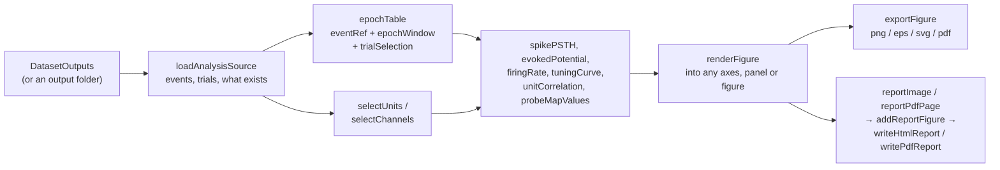
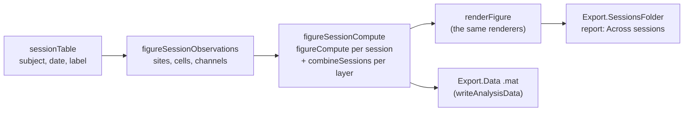

# Analysis: quick-look figures

The [`analysis`](../analysis) folder turns the pipeline's outputs into
figures: rasters and PSTHs, evoked potentials, firing rates, tuning curves,
heat maps, probe maps, unit-by-unit correlation matrices and auROC curves,
as panels of figures that put several of them side by side for one unit,
channel or dataset.
Every figure can be aligned to **any digital line**
(onset or offset; the first, last, every or nth interval per trial), and
trials can be **filtered and grouped by Epsych2 parameters** (Depth,
TrialType, response bits). Figures are exported as PNG / EPS / SVG / PDF and
collected into a self-contained HTML report and / or a multi-page PDF.
Per-unit response tests and a population analysis over every unit of every
dataset give numbers as well as figures. A figure can also be drawn
[across sessions](#across-sessions): the same figure computed on several
datasets and merged (a color per session or per subject, or a mean with an
error band across sessions), with the data behind it saved as a `.mat` file.

It is for quick looks. Multitaper spectra, spectrograms and coherence are the
Figures tab's [spectral panels](EphysAnalysisConfig.md#spectral-panels), run by its
[Chronux analyses](#chronux-analyses); anything further belongs in
[Chronux](ChronuxDataset.md) or [FieldTrip](FieldTripExport.md).

`analysis` depends on `pipeline`: it reads the outputs through
[`DatasetOutputs`](DatasetOutputs.md). `pipeline` needs `analysis` only for
its Analysis step, which runs an analysis config over the pipeline's
selected datasets ([EphysPipeline → Analysis step](EphysPipeline.md#analysis-step);
the pipeline app's **Analysis** tab), and for the links that open
[`EphysAnalysisApp`](EphysAnalysisApp.md): the pipeline app's **File → Open
analysis app...**, the Project tab's **Tools** panel (**Analysis app**) and
the Analysis tab's **Open in the analysis app**. Without `analysis` on the
path, everything else in the pipeline still runs.
`addpath_nogit('C:\src\ephys_analysis')` puts both on the path.

<!-- wiki: More on `DatasetOutputs` in [Loading outputs](Loading-Outputs). -->

Everything the app does can be done from a script, at three levels, each
usable without the next:

| Level | What you write | Use it to |
| --- | --- | --- |
| [Config + runner](#runner) | load or build an [`EphysAnalysisConfig`](EphysAnalysisConfig.md), run it with `EphysAnalysisRunner` | draw a saved set of figures over many datasets, e.g. after every pipeline run |
| [Generated scripts](#generated-scripts) | `EphysAnalysisScript.compact` / `.standalone` / `.preview` | reproduce an app session exactly, see every call a run makes, or take one previewed figure into a script of your own |
| [The functions](#a-worked-script) | `loadAnalysisSource`, `epochTable`, `spikePSTH`, `figureCompute`, `renderFigure`, ... | your own alignment, your own figure layout, or numbers instead of figures |

The app, [`EphysAnalysisApp`](EphysAnalysisApp.md), is a GUI over the runner.

## A worked script

The runner is a thin sequence of public functions. Call them yourself to
align differently, draw into your own figures, or keep the numbers.



`loadAnalysisSource`, `selectUnits` and `selectChannels` read the files; the
compute functions are pure (no file reading, no graphics); the renderers
draw into a target you give them and never create figures.

<!-- wiki: Their full signatures are on [Analysis functions](API-Analysis-Functions). -->

```matlab
addpath_nogit('C:\src\ephys_analysis')               % pipeline + analysis
out = DatasetOutputs("D:\EPHYS\SYNTH-01\SYNTH-01_260918_101500", CacheData=true);
src = loadAnalysisSource(out);                        % events, trials, what exists
src.lines                                             % the digital lines: Line, Count, MeanDurationSec, ...
src.paramNames                                        % the Epsych2 parameters to filter and group by

% epochs: the first Stim onset of every paired trial, grouped by Depth
ref = eventRef(line="Stim", edge="onset", which="first", scope="trial");
win = epochWindow(pre=-0.2, post=0.8);
sel = trialSelection(filter="Hit | Miss", groupBy="Depth");
[E, G] = epochTable(src, ref, Window=win, Selection=sel);

% sorted units -> PSTH + raster: the numbers, R.rate [bins x units x groups]
[st, meta] = selectUnits(src, struct('source', "units", 'classes', "su"));
R = spikePSTH(st, E, Window=[-0.2 0.8], BinSec=0.01, SmoothSec=0.01, Groups=G, Meta=meta);
R.epochs = E;

% the same, drawn: a figure says what to draw for one observation (a unit, a channel
% or the dataset); figureCompute computes it and renderFigure draws it
cfg = EphysAnalysisConfig();
cfg.Defaults.EventRef = ref;  cfg.Defaults.Window = win;  cfg.Defaults.Selection = sel;
cfg = cfg.addFigure("rasterPsth", Id="unit_card");    % a unit's raster flush over its PSTH
spec = cfg.figureFor("unit_card");                    % every "default" resolved
obs = figureObservations(src, spec);                  % one row per unit the figure is drawn for
F = figureCompute(src, spec, Observation=obs(1, :));  % no graphics
fig = newExportFigure(struct('FigureSizeCm', [18 12]), F, spec);
renderFigure(F, spec, fig);
exportFigure(fig, "D:\out\unit_card_su1", Format=["png" "svg"], Dpi=150);
close(fig)

% LFP evoked potential, baseline subtracted
[Y, fs, cm] = selectChannels(src, "LFP");
V = evokedPotential(Y, fs, E, Window=[-0.1 0.5], Baseline=[-0.1 0], Groups=G, Meta=cm);
```

The other kinds take the same epochs and units:

```matlab
% firing rate per epoch, baseline subtracted; a tuning curve over Depth
Fr = firingRate(st, E, Baseline=[-0.2 0], Normalize="subtract", Groups=G, Meta=meta);
[Et, Gt] = epochTable(src, ref, Window=win, Columns="Depth");   % Depth on every epoch
Ft = firingRate(st, Et, Groups=Gt, Meta=meta);
T = tuningCurve(Ft.rate, Et.Depth, Param="Depth", Meta=meta, Units=Ft.units);

% unit-by-unit correlation of the peak binned rate, Spearman
C = unitCorrelation(st, E, Metric="peak", BinSec=0.01, SmoothSec=0.01, Type="spearman", Groups=G, Meta=meta);
C.r(:, :, 1)                                          % [nUnits x nUnits] of the first group
figure; renderCorrMap(C, gcf, Style=struct('HeatColormap', "turbo", 'CLim', [-0.5 0.5]));

% a value per probe site
U = unitSummary(src, Source="units");                 % label, class, channel, shank, x, y, nSpikes, rateHz, starred
P = probeMapValues(U, src.probe, Value="rate");
figure; renderProbeMap(P, [], gcf);
```

A figure holds panels of any of these kinds on a grid (a raster over a PSTH over
an LFP trace of the unit's own channel, a heat map, a probe map, ...); each panel's
layers call the compute functions above, and `renderFigure` draws them with
`renderHeatmap`, `renderProbeMap`, `renderCorrMap` and `renderWaveforms` where a
panel is one of those maps ([Figures](#figures) below).

## The source

`src = loadAnalysisSource(out)` takes a
[`DatasetOutputs`](DatasetOutputs.md) (or a folder, which becomes
`DatasetOutputs(folder, CacheData=true)`) and reads the small things every
analysis needs. **No signal and no spike time is loaded**: `selectUnits` and
`selectChannels` load those through `src.outputs` when a figure needs them.

| Field | Meaning |
| --- | --- |
| `name`, `key`, `folder`, `outputs` | the dataset, its key (`Key=` option), output folder and `DatasetOutputs` |
| `fs`, `durationSec` | recording rate and length: the manifest's `metadata.fs` / `duration_s`, else the extract (`info.origFs`, `info.<SIG>.nSamples / Fs`), else the pairing. Rates divide by `durationSec`, never by the time of the last spike. `fs` is also the rate the digital-event rows count at (`t = row/fs`), which `epochTable` uses |
| `events` | line → `[k x 2]` `[t_on t_off]` s, **polarity applied**, from the extract (the smallest extract file's `events`), plus every derived event of the behavior file |
| `derivedEvents` | the behavior file's [derived events](EphysPipeline.md#derived-events) (`name`, `line`, `conditions`, `combine`, `expression`, `description`, `intervals`, ...; empty without) |
| `artifacts` | `[k x 2]` `[tStart tEnd)` s on the continuous clock (row r at `(r − 1)/fs`): the artifact periods the Signals step erased (that file's `info.artifacts.intervals`; `zeros(0,2)` when none). `epochTable` drops the epochs that touch one, for spike figures too, unless the selection's `excludeArtifacts` is off (only periods of at least its `minArtifactSec` count). Only these periods count: with `Signals.BlankArtifacts` off (or `Artifacts.ApplyToSignals` off while sorting or detection used the automatic periods) the periods erased before sorting or detection are not here |
| `invertedLines`, `lines` | lines inverted; table `Line, Count, MeanDurationSec, First, Last, Inverted, Derived` (a derived event's description, `""` for a recorded line) |
| `labels` | amplifier channel labels (`info.labels`) |
| `signals`, `signalFs` | `LFP / MUA / SPIKE / AUX` → extract present, and its rate |
| `hasBehavior`, `hasTrials` | a behavior file was found; it carries the trial pairing (`TrialOnset`, `TrialEvents`, ...) |
| `trials`, `nTrials`, `pairing` | `behavior.trials` (text columns as `string`), `behavior.pairing` |
| `paramNames` | every trial column but the pairing's times and samples (`TrialOnset`, `TrialOffset`, `TrialOnsetSample...`, `TrialEvents`, `TrialEventSamples`), `RespCode` included, in alphabetical order (ignoring case) |
| `respField` | `"RespCode"`, `"ResponseCode"` or `""` |
| `trialLine`, `subject`, `startTime` | from the pairing and the session |
| `probe`, `probeFile`, `probeSource` | the manifest's `probe.file`, decoded (`chanMap` 0-based, `xc`, `yc` µm, `kcoords`). Without one (a dataset sorted with the pipeline's default probe, which the manifest records only with `Probe.WriteDefaultToManifest`), the map the sort used: its `channel_map.npy`, `channel_positions.npy` and `channel_shanks.npy`, in the same fields. `probeSource` says which: `"manifest"`, `"sorting"` or `""` (none) |
| `hasUnits` | the sorting folder holds sorted units (read once through `DatasetOutputs.load("sorting")`) |
| `hasDetected`, `spikesFile` | the spikes file holds threshold detections |

## Event reference, window, selection

Three small structs describe an alignment. Each constructor fills what you
leave out from [`EphysAnalysisConfig.defaults`](EphysAnalysisConfig.md#building-blocks),
coerces the rest and checks it: `eventRef(Name=Value)` or `eventRef(s, Name=Value)`.

### `eventRef`: what each epoch is aligned to

| Field | Default | Meaning |
| --- | --- | --- |
| `line` | `"Stim"` | digital line; `"Trial"` is the paired trial line |
| `edge` | `"onset"` | `"onset"` or `"offset"` of each interval |
| `which` | `"first"` | `"first"`, `"last"`, `"all"`, `"nth"` (per trial in trial scope, over the recording otherwise) |
| `n` | 1 | the interval `"nth"` takes |
| `scope` | `"auto"` | `"trial"`: the line's intervals whose edge lies inside each selected trial, `[TrialOnset, TrialOffset]` (an interval spanning several trials counts once, for the trial holding its edge); `"recording"`: every interval (`src.events`); `"auto"`: trial when the dataset has paired trials |
| `minDurationSec`, `maxDurationSec` | 0, `Inf` | keep intervals whose length is in range |
| `timeRange` | `[-Inf Inf]` | keep events in range: from the trial onset (trial scope) or the recording start |
| `offsetSec` | 0 | added to every event time |
| `offsetParam` | `""` | a numeric trial parameter, e.g. `"RespLatency"`: each event is moved by its trial's value of it, so epochs can be aligned to a per-trial time such as the response (`line "RespWindow"`, `offsetParam "RespLatency"`). Needs paired trials; an event outside the trials, or whose trial has no finite value (a miss), is dropped |
| `offsetParamUnit` | `"ms"` | `offsetParam`'s unit: `"ms"` (as Epsych2 stores times) or `"s"` |
| `sequence` | none | steps that must (or must not) follow each event: a struct array of `relation` (`"followedBy"` / `"notFollowedBy"`), `line`, `edge`, `n`, `maxGapSec`, `minDurationSec`, `maxDurationSec` ([event sequences](EphysAnalysisConfig.md#event-sequences)) |
| `alignStep` | `Inf` | the sequence's event each epoch is aligned to: `0` the line's own, `k` step `k`, `Inf` the last followedBy step |

An event can be a sequence of events. The first Trough onset after the end
of each CR trial:

```matlab
ref = eventRef(line="Trial", edge="offset", sequence=struct('line', "Trough"));
E = epochTable(src, ref, Selection=trialSelection(response="CR"));
```

Each step looks for its event after the event before it (never past the
next trial's onset), within its `maxGapSec`; an event whose sequence does not
complete is left out before `which` picks, and counted
(`nDroppedNoSequence`). The trial stays the one holding the line's own
event, so the CR selection applies to the trial that ended. Steps whose
fields differ go in a cell: `sequence={struct('line', "Trough"),
struct('line', "Trough", 'edge', "offset")}`. `eventRefLabel(ref)` names
it: `"Trial offset then Trough onset"`.

`resolveEvents(src, ref, mask)` returns the event times `t`, the trial row of
each (`NaN` outside trials) and its rank. An interval belongs to the trial
whose `[TrialOnset, TrialOffset]` holds its `edge`, in both scopes: once, and
an edge on the boundary of two touching trials belongs to the earlier trial.
In trial scope `"Trial"` (or the trial line itself) is the trial's own
`[TrialOnset TrialOffset]`, and a line whose intervals lie between trials
(`Platform` on the synthetic fixture) has no event: use recording scope for
it. In recording scope each event is assigned the trial that holds its edge;
with a restrictive selection (below) events outside the kept trials are
dropped. With `offsetParam` each event is then moved by its trial's value
(`[t, trial, k, shift, nNoValue] = resolveEvents(...)`: `shift` the
seconds added, `nNoValue` the events dropped for lacking a value), and the
events are sorted after the shift; the trial is still the one holding the
unshifted edge. With a `sequence`, `t` is each event's `alignStep` event,
`trial` and `k` those of the line's own event, and a sixth output
`nNoSequence` counts the events it cost. Errors: `resolveEvents:NoTrials` (also `offsetParam`
without paired trials), `resolveEvents:NoLine`, `resolveEvents:NoParam` /
`resolveEvents:BadParam` (`offsetParam` is not a numeric trial column),
`resolveEvents:NoEvents`.

### `epochWindow`: the span of each epoch

| Field | Default | Meaning |
| --- | --- | --- |
| `mode` | `"fixed"` | `"fixed"`: `[t0+pre, t0+post]`; `"between"`: `[t0+pre, t1+post]` where `t1` is the stop event |
| `pre`, `post` | -0.2, 0.8 | seconds |
| `stop` | `[]` | an `eventRef` ending each epoch. Required for `"between"`. In `"fixed"` mode it still fills `t1`, so renderers mark it and `spikePSTH` can mask after it |

The stop event of an epoch is the first (`stop.which`) stop event at or
after `t0`, in the same trial when the epoch has one: it is looked up among
the intervals overlapping that trial, so it may fall after the trial ends. Use
`"between"` for a variable-length period, e.g. `RespWindow` onset →
`RespWindow` offset. A stop with its own `offsetParam` is moved by the
epoch's trial's value of it (no stop when that trial has none): with
`stop=eventRef(line="RespWindow", offsetParam="RespLatency")` each
stimulus-aligned epoch's `t1` is its response. A stop with a `sequence` is
the first of its line's events at or after `t0` whose sequence follows,
e.g. `stop=eventRef(line="RespWindow", edge="offset", sequence=struct('line', "Trough"))`
stops at the first Trough onset after the response window.

`eventLatency(src, E, ref)` finds any other event the same way, without
making it the stop: each epoch's latency in s from `t0` to the first event
of `ref` at or after it (NaN where none follows). With
`ref=eventRef(line="Platform", edge="offset")` it is how long after each
epoch's event the animal left the platform; a raster can be sorted by it
(`rasterSort "event"`).

### `trialSelection`: which trials, in which groups

| Field | Default | Meaning |
| --- | --- | --- |
| `filter` | `""` | an expression over `behavior.trials`, e.g. `Depth > 0 & RespLatency < 500` or `Hit \| Miss` |
| `response` | none | keep trials that are **any** of these response words |
| `pairingFlags` | `"ok"` | keep trials with this `PairingFlag` (`[]` keeps every flag) |
| `trials` | `[]` | explicit rows of `behavior.trials` |
| `groupBy` | none | 0-2 parameters; one group per value (pair of values) |
| `groupOrder` | `"ascending"` | `"ascending"`, `"descending"` or `"appearance"` |
| `maxGroups` | 12 | more groups is `selectTrials:TooManyGroups` |
| `excludeArtifacts` | `true` | leave out the epochs that touch an artifact period (`src.artifacts`); `false` keeps them, flagged in `epochTable`'s `artifact` column |
| `minArtifactSec` | 0 | only artifact periods at least this long count (for `excludeArtifacts` and the `artifact` column alike) |

Response words are the bits of `RespCode` ([`respCodeBits`](../pipeline/respCodeBits.m)):
Hit 1, Miss 2, CR 4, FA 8, Abort 16, Reward 32, Punish 64, NoResponse 128, Response 256.

**Filters** are compiled from an allow-list and never passed to `eval`:
column names become `T.("name")`; response words `bitand(RespCode, bit) > 0`
(a column of the same name wins); `!` is `~`, `!=` is `~=`, a single `=` is
`==`, `&&` / `||` are the row-wise `&` / `|`; the functions `abs round floor
ceil fix mod rem min max isnan isfinite ismissing ismember any all strcmp
strcmpi contains startsWith endsWith lower upper string double bitand` and
`true false pi NaN Inf` are allowed; field access, `;`, `@` and every other
name are rejected (`trialSelection:BadFilter`). Text columns compare with
`==`. A parameter whose name is not a valid MATLAB identifier can only be
grouped by, not filtered on. The same language defines the pipeline's
derived events (below), compiled by
[`tableFilterFcn`](../pipeline/tableFilterFcn.m).

**Derived events.** The pipeline's derived events (`Behavior.DerivedEvents`,
[`deriveEvents`](../pipeline/deriveEvents.m); defined on its Trials tab) are
lines like any other here: each is a line of `src.events` and of every
trial's `TrialEvents`, so `eventRef(line="Shallow")` aligns to it in either
scope, and `src.derivedEvents` holds the definitions (the Data tab's lines
table shows each one's under **Derived from**). One made with **Include in the
original dataset** is also a true / false trial column of its name, so
`filter="Shallow & Hit"` or `groupBy="Shallow"` work too.

`[mask, G, gi] = selectTrials(src, sel)` applies it: `mask` over
`src.trials`, the groups table `G` (`index, label, color, n, <params>`, labels
like `"Depth = 0.5"`), and each trial's group. Colors: a numeric parameter
with more than two values runs through parula; otherwise `lines`; one
ungrouped set is dark gray. Without paired trials there is one group
`"all"`, and a filter / response / trials / groupBy raises
`selectTrials:NoTrials`.

### `epochTable`

`[E, G] = epochTable(src, ref, Window=win, Selection=sel, Incomplete="drop", Artifacts="drop", Baseline=[], Columns=[])`
gives one row per epoch, by time: `epoch, trial, t0, t0Continuous, t1,
tStart, tStop, duration, complete, artifact, groupIndex, group` and the `groupBy` (and
`Columns`) parameters of each epoch's trial. `t0` is the digital-event time
(`t = row/fs`); `t0Continuous` is the same event on the continuous clock of the
signals and spike times, `(row-1)/fs` = `t0 - 1/fs` (plus `offsetSec`),
computed from the row so that it equals the time of a spike in that sample.
`tStart` / `tStop` are on the clock of `t0`. `complete` means the window lies inside the
recording and, in `"between"` mode, has its stop event; incomplete epochs are
dropped unless `Incomplete="keep"`. `artifact` means the window, shifted to
the continuous clock (by `t0Continuous - t0`), touches one of `src.artifacts`
at least the selection's `minArtifactSec` long (half-open periods:
`EphysDataset.overlapsIntervals`); those epochs are dropped, for signal and
spike figures alike, when the selection's `excludeArtifacts` is on (the
default), unless `Artifacts="keep"`, which keeps them flagged whatever the
selection says (so with the defaults the column is always false).
`Baseline=[b0 b1]` (s from `t0`) widens that test to a baseline window that
reaches outside `[tStart, tStop]`; the runner passes each panel's baseline.
`G.n` is the number of epochs per group,
`G.nTrials` the kept trials. With `ref.offsetParam`, `t0` and
`t0Continuous` both carry the shift (`t0Continuous` is still the event's
sample on the continuous clock, `t0 - 1/fs`). `E.Properties.UserData`
records `ref`, `window`, `selection`, `scope`, `nEvents`,
`nDroppedNoValue` (events `offsetParam` dropped; not in `nEvents`),
`nDroppedNoSequence` (events the `sequence` cost; not in `nEvents`),
`nDroppedNoStop`, `nDroppedEdge`, `nDroppedArtifact`, `nTrials`,
`nTrialsSelected` and `dataset`. Nothing usable is `epochTable:NoEpochs`; an
unknown `src.fs` is `epochTable:NoRate`.

To see how a reference, window and selection cut a dataset,
`d = EpochDiagram(); d.update(src, ref, win, sel, Baseline=b)` draws it:
the digital lines as TTL traces with each event, window and epoch, the
epochs dropped and why, and the epochs aligned to their event. `d.Epochs` is
the `epochTable` with every event kept, plus `kept`, `number` and `reason`.
It is the app's [epoch diagram](EphysAnalysisApp.md#epoch-diagram).

### Units and channels

`[st, meta] = selectUnits(src, usel)` loads spike trains: `st` is
`{nUnits x 1}` spike times (s) and `meta` a table `label, unitId, class,
channel, channelName, shank, x, y, nSpikes`. `usel.source` is `"units"`
(sorted units, filtered by `classes`, `groups`, `ids`) or `"detected"`
(threshold detections, one "unit" per channel, class `"det"`, sites from the
probe map); both filter by `channels`, `shanks` and `maxUnits`. Shanks are
the probe map's `kcoords` values for both: a sorted unit on a mapped channel
takes its channel's shank, since the sorter's own shank numbers
(`channel_shanks.npy`) need not match them. Everything downstream
treats the two alike. `usel.quality` keeps the sorted units that meet
good-unit criteria, and `usel.response` the units that respond to the event
([response statistics](#response-statistics)). The response test needs the
events: `selectUnits(src, usel, Ref=ref, Selection=sel)` (the runner passes the figure's own; `unitSummary` takes the same two options).
`usel.response.test` is `"evoked"` (responsive), `"tuning"` (tuned across
the levels of `param`), `"either"`, `"both"` or `"auroc"`: the units the
auROC calls modulated ([auROC](#auroc)). That test runs `aurocCurves` over
the test's epochs as one group, against `response.baseline`, with
`response.window` as the modulation window, auROC windows over
`[min(b0, w0) max(b1, w1)]`, its own bins (`response.auroc.binSec`) and
`response.auroc`'s `method`, `windows`, `windowSec`, `stepSec`, `cutoff`
(not `"none"`), `threshold`, `test` and `nResamples`; `correction` and
`alpha` are the response test's. `direction`
`"excited"` / `"suppressed"` (the evoked and auROC tests) keeps only the
units responding, or called, up / down. `meta` gains the test's columns:
`baselineRate, responseRate, pEvoked, qEvoked, direction, responsive`
(and, with `param`, the tuning test's), or for `"auroc"` `aurocMean,
aurocPhasic, aurocP, aurocQ, aurocDirection, aurocModulated`. `maxUnits`
applies after the test.

`[Y, fs, meta] = selectChannels(src, "LFP", Channels=...)` loads one derived
signal (`LFP`, `MUA`, `SPIKE` or `AUX`) through the outputs' cache: `Y` is
`[nSamples x nChannels]` single µV (AUX volts). `meta` has `label, channel`
(extract column), `recordingChannel` (`keepAmpChannels(channelRemap(c))`),
`shank, x, y, units`. With every channel in order, `Y` is the cached signal
itself, not a copy, and `evokedPotential` reads only the epochs' rows from it.
A MUA at 2 kHz × 64 channels × 1 h is about 1.8 GB, so
load one signal at a time and `clearCache()` between datasets (the runner
does).

## Time base

- Continuous signals: row `k` is at `t = (k-1)/Fs`, at every rate; spike
  times are seconds on the same clock.
- Digital events: `t = row/Fs` of the recording, one sample later for the same
  row. An event at row `r` happened at `(r-1)/Fs`, which is `E.t0Continuous`.
- `evokedPotential` uses rows `round(t0Continuous*fs) + 1 + (s0:s1)`, with
  `s0 = round(pre*fs)`, `s1 = round(post*fs)` and `R.t = (s0:s1)'/fs`: offset 0
  is the event's own sample at the recording rate, the nearest sample at a
  derived rate, as in `ChronuxDataset.trials` (`OnsetRule="event"`) and the
  pairing's `TrialOnsetSample_<SIG>`.
- Spikes are taken relative to `t0Continuous` (a spike in the event's own
  sample is at 0), and the windows of `firingRate` and `unitCorrelation` are
  moved to the spikes' clock by `t0Continuous - t0`.
- An event shifted by a trial parameter (`offsetParam`) carries the shift
  on both clocks, `t0 = row/Fs + offsetSec + shift` and `t0Continuous =
  (row-1)/Fs + offsetSec + shift`, so it need not fall on a sample. A
  raster's event marks (`epochEvents`) are digital-event times taken from
  `t0`, so they sit where the spikes of their sample sit.

## Compute

Pure functions, but for `unitSummary`, which loads the units through
`selectUnits`: no I/O, no graphics. Every result `R` carries `kind`,
`params`, `groups`, `labels`, `n`, `units` (the measurement unit) and
`created`; the runner adds `epochs`, `dataset` and `spec`.

| Function | Result |
| --- | --- |
| `spikePSTH(st, E, Window=, BinSec=, SmoothSec=, Measure=, Baseline=, BaselineMode=, MaskAfterStop=, Raster=, Groups=, Meta=, Auroc=, ErrorType=, ErrorResamples=)` | `t, edges, window, rate / sem / count [nBins x nUnits x nGroups], nEpochs, raster, epochGroup, epochStop, stopMean, baselineRate, baselineSD`. Defaults: `Window` `[-0.2 0.5]`, `BinSec` 0.01, `SmoothSec` 0 (a figure's default is 0.01), `Raster` true (`R.raster` keeps every spike's time relative to its event). Spikes are taken relative to each epoch's `t0Continuous`. Bins are whole multiples of `BinSec` from the event, `[k, k+1)·BinSec`, so the event is always an edge and no bin mixes spikes from before and after it; they are half-open (a spike exactly at a bin's end is in the next one). The window shrinks to the whole bins inside it, `R.window` (`[-0.25 0.5]` in 0.1 s bins is `[-0.2 0.5]`); one that holds no whole bin is `spikePSTH:BadWindow`. `Measure` is `"rate"` (default, spikes/s), `"count"` (spikes per bin per epoch) or `"probability"` (the share of epochs with a spike in the bin; its baseline uses whole `BinSec` bins from `b0`). Smoothing (Gaussian SD) applies to each epoch before averaging, renormalized at the edges. Baseline modes `none`, `subtract`, `zscore`, `percent` (per group, from spikes counted in the baseline window), or `auroc`: the curves become `aurocCurves`' auROC windows, `sem` NaN and `units` `"auROC"`, unsmoothed (`Auroc` holds its settings; `R.auroc` the calls; see [auROC](#auroc)). Named `spikePSTH` so it does not shadow Chronux's `psth`. `ErrorType=` (`"sem"` default, `"std"`, `"ci95"`: a bootstrap 95% CI of the mean, percentile, `ErrorResamples=` resamples, 1000; `errorBounds`) makes `R.err`: `type`, `lo` / `hi` (the band's edges, shaped as the means), `over` `"epochs"`, `nBoot` ([Error bands](EphysAnalysisConfig.md#error-bands)); a baseline mode moves and scales its edges as it does the rates, an auROC has none |
| `evokedPotential(Y, fs, E, Window=, Channels=, Baseline=, Detrend=, Incomplete=, KeepEpochs=, Magnitude=, Groups=, Meta=, Units=, Rectify=, Statistic=, ErrorType=, ErrorResamples=)` | `t, mean / sem [nTime x nChan x nGroups], nEpochs, data (KeepEpochs), channels, labels, channelLabels, magnitude, statistic, rectified, fs, units, sampleOffsets, onsetRule "event", keptEpochs, droppedEdge, droppedNonFinite`. Epoch *e* is rows `round(E.t0Continuous(e)*fs) + 1 + (s0:s1)`: onset rule `"event"`, offset 0 the sample nearest the one that produced the event (at the recording rate, that very sample). Only the epochs' rows of the used channels are read from `Y`. `Magnitude=true` combines each epoch's channels into one, `sqrt` of the sum of their squares at every sample, after `Detrend` and `Baseline` and before the average (the mean of the magnitudes); a sample missing in any channel is missing in it. `R` then has one channel, labeled `"|AUX1, AUX2, AUX3|"`, `channelLabels` the channels combined and `meta` `[]`. `ErrorType=` (`"sem"` default, `"std"`, `"ci95"`: a bootstrap 95% CI of the mean, percentile, `ErrorResamples=` resamples, 1000; `errorBounds`) makes `R.err`: `type`, `lo` / `hi` (the band's edges, shaped as the means), `over` `"epochs"`, `nBoot` ([Error bands](EphysAnalysisConfig.md#error-bands)); `"ci95"` holds the epochs in single precision, as `KeepEpochs` |
| `firingRate(st, E, Measure=, Baseline=[b0 b1], Normalize=, ErrorType=, ErrorResamples=)` | `rate / count [nEpochs x nUnits]` over each epoch's `[tStart, tStop)`, moved to the spikes' clock by `t0Continuous - t0`, `duration`, `baseline` (`[b0 b1]` s around the event), `meanRate / sem / median [nUnits x nGroups]`, `baselineRate`. `Measure`: `rate` (default), `count` (spikes per window) or `probability` (1 for an epoch with a spike in its window; a group's mean is the share of such epochs). `Normalize`: `none`, `subtract` (per epoch), `ratio`, `zscore` (the unit's baseline over all epochs). `ErrorType=` (`"sem"` default, `"std"`, `"ci95"`: a bootstrap 95% CI of the mean, percentile, `ErrorResamples=` resamples, 1000; `errorBounds`) makes `R.err`: `type`, `lo` / `hi` (the band's edges, shaped as the means), `over` `"epochs"`, `nBoot` ([Error bands](EphysAnalysisConfig.md#error-bands)) of each unit's mean per group |
| `tuningCurve(rates, x, Series=, Param=, SeriesParam=, ErrorType=, ErrorResamples=)` | `x` (sorted values), `series`, `mean / sem [nX x nUnits x nSeries]`, `n [nX x nSeries]`. Epochs without a value are left out; when none has one (recording-scope events that all fall outside the trials, say) it is `tuningCurve:NoValues`. `ErrorType=` (`"sem"` default, `"std"`, `"ci95"`: a bootstrap 95% CI of the mean, percentile, `ErrorResamples=` resamples, 1000; `errorBounds`) makes `R.err`: `type`, `lo` / `hi` (the band's edges, shaped as the means), `over` `"epochs"`, `nBoot` ([Error bands](EphysAnalysisConfig.md#error-bands)) of each value's mean |
| `unitSummary(src, Source=, Units=, Ref=, Selection=)` | table `label, class, channel, shank, x, y, nSpikes, rateHz, starred` with `rateHz = nSpikes / src.durationSec` and `starred` the unit's [star](#favorites-stars) on the sort in use (a detection channel's: its channel's) |
| `probeMapValues(T, probe, Value=)` | one value per probe site: `rate` (summed Hz), `nSpikes`, `nUnits` |
| `epochEvents(src, E, Lines=, Edge=, Scope=, Sequences=)` | a raster's event marks: a struct per line and edge (`Edge` `"onset"`, `"offset"` or `"both"`), with `line`, `edge`, `label` (`"Trough onset"`), and for every event of that line inside each epoch's window (`Scope="window"`, the default) or inside the epoch's own trial too (`Scope="trial"`) its epoch (`epoch`, a row of `E`) and its time from the epoch's event (`t`, s, on the clock of `E.t0`). Every event is kept, so a trial with several beam crossings has several. `Sequences=` (event references with [sequences](EphysAnalysisConfig.md#event-sequences)) adds a struct per sequence after the lines, labeled by `eventRefLabel` (`"Trial offset then Trough onset"`): its events (`resolveEvents` over every trial, at each one's `alignStep`) in each epoch's window, and with `Scope="trial"` only those whose sequence started in the epoch's trial; one that never completes is an empty mark. `figureCompute` calls it for an events layer drawn as marks (a raster's `R.rasterEvents`) |
| `eventMarkRef(marks)`, `rasterMarkLabels(marks)`, `rasterMarkLooks(marks, labels)` | a figure's raster marks (an events layer's `event`, [Raster event marks](EphysAnalysisConfig.md#raster-event-marks)): their event references without the look (what `epochEvents(..., Sequences=)` takes), their labels (as `epochEvents` gives them), and each label's marker, size and color |
| `[lat, label] = eventLatency(src, E, ref)` | `lat` `[height(E) x 1]`: each epoch's latency in s from its event `t0` to the event of the `eventRef` `ref` that follows it, found as [the stop event](#epochwindow-the-span-of-each-epoch) is: the first (`ref.which`) event of `ref` at or after `t0`, among the intervals overlapping the epoch's own trial when it has one (scope `"trial"` or `"auto"`), else over the recording; `offsetSec`, `offsetParam` and `sequence` apply as to a stop. NaN where none follows. `label` names the event: its `eventRefLabel`, with `which` when it is `"last"` or `"nth"` and its shifts (`"RespWindow onset + RespLatency (ms)"`). `figureCompute` calls it for a raster, or a heat map of trials, sorted by an event (`rasterSort "event"`) as `R.rasterSortEvent` (`label`, `t`) |
| `firstSpikeLatency(R, Units=, MinSec=, MaxSec=)` | each epoch's first-spike latency from a `spikePSTH` result's raster rows (`Raster=true`, or rows merged across sessions): `lat` `[nEpochs x nUnits]`, s from the epoch's event to its first spike at or after `MinSec` (default 0) and at or before `MaxSec` (default `Inf`: the window's end), both included to the sample; NaN where none. The spikes are the raster's own (relative to each `t0Continuous`, the stop mask applied), so a latency sits on the tick it marks. Also `spikeTime` (that spike on the continuous clock, with `R.epochs`), `window` (searched, clipped to `R.edges`), `units`, `labels`, `epochGroup`, `groups`, `n` `[nGroups x nUnits]` (the epochs with a first spike) and `nEpochs`. Errors `firstSpikeLatency:NoRaster`, `:BadWindow`, `:BadUnit`. A raster panel's first-spike marks and a PSTH panel's latency box plot read it ([First-spike latency](EphysAnalysisConfig.md#first-spike-latency)) |
| `unitCorrelation(st, E, Metric=, Type=, FisherZ=, BinSec=, SmoothSec=, Baseline=, BaselineMode=, Groups=, Meta=)` | `r / p [nUnits x nUnits x nGroups]`, `z` (with `FisherZ=true`: atanh r, NaN on the diagonal), `meanR` (mean over the pairs; with `FisherZ`, averaged in z and transformed back), `nEpochs`, `response [nEpochs x nUnits]`. Each epoch's response is its `"mean"` rate over `[tStart, tStop)` (moved to the spikes' clock by `t0Continuous - t0`) or its `"peak"` binned rate (bins from `tStart`; a bin that runs past `tStop` is not used), optionally minus the epoch's baseline rate (`BaselineMode="subtract"`); every pair of units is then correlated over the epochs of each group, `Type="pearson"` or `"spearman"` (ties averaged). Fixed and `"between"` windows. An epoch whose response is not finite (a window shorter than one bin) is left out; a unit whose responses do not vary has NaN correlations, and so does every pair of a group with fewer than 3 epochs. Needs no toolbox; `p` is two-sided from the t distribution |

## Response statistics

`[T, info] = responseStats(st, E, Baseline=[b0 b1], Window=[w0 w1], Param=,
Correction=, Alpha=, Meta=)` tests every unit over the epochs of `E`. The
tests are the Statistics and Machine Learning Toolbox's own; the repository
adds only the counting and the p-value adjustment.

- **Counts.** Spikes per epoch in the baseline window `[t0+b0, t0+b1)` and
  the response window `[t0+w0, t0+w1)`, counted by `firingRate` on the
  spikes' clock (from `t0Continuous`).
- **Evoked.** `signrank(response, baseline)`: the Wilcoxon signed-rank test
  of the paired rates, two-sided, with `signrank`'s default method.
  `direction` comes from the two one-sided tests (`tail` `"right"` /
  `"left"`): `"excited"`, `"suppressed"`, or `"none"` when the two agree to
  1e-12 (equal rank sums).
- **Tuning** (with `Param`). `kruskalwallis(response, E.(Param), "off")`
  across the parameter's levels. Epochs without a level are left out. A
  unit with fewer than two levels is not tested. `bestLevel` is the level
  with the highest mean response rate (on a tie, the first in sorted
  order), and `bestRate` is that mean.
- **Counts or rates.** When the two windows are equally long, the tests
  run on the counts. Rates are the counts over one constant, so the result
  is the same, but the paired differences have no rounding error.
  Otherwise the tests run on the rates.
- **Correction.** Each test's p values are adjusted over the units tested
  with `pAdjust(p, Correction)`: `"bh"` (Benjamini-Hochberg, default),
  `"holm"`, `"bonferroni"` or `"none"`. Its results are R's `p.adjust`
  (NaN is not a test). The Statistics and Machine Learning Toolbox has no
  such function, so this is the one piece written here, and it is checked
  against statsmodels. A unit is `responsive` / `tuned` when its adjusted p
  is at most `Alpha` (default 0.05).
- **Epochs used.** Only epochs whose window `[tStart, tStop]` holds both
  test windows, since that is where `epochTable` checked the recording's
  ends and the artifact periods. The others are left out with
  `responseStats:EpochsLeftOut`: epochs flagged incomplete or artifact, and
  epochs too short for the windows. `selectUnits` builds its own epochs for
  the test: one fixed window `[min(b0,w0), max(b1,w1)]`.

`T` has one row per unit: `unit, label, nEpochs, baselineRate, responseRate,
pEvoked, qEvoked, direction, responsive` and, with `Param`, `nLevels,
pTuning, qTuning, tuned, bestLevel, bestRate`. A unit that is not tested has
NaN p and q and direction `""`. `info` records the windows, `param`,
`correction`, `alpha`, `tests`, `nEpochs`, `nEpochsLeftOut`, `nTestedEvoked`,
`nTestedTuning`, `counts`, the levels with the mean response rate and the
epochs per level and unit (`levels`, `levelRate`, `levelN`), and the toolbox
version. Without the toolbox it is `responseStats:NoToolbox`.
`Tests=false` skips the tests, so no toolbox is needed: the rates, the
per-level rates and `bestLevel` come out, with every p NaN.
`responseEpochs(src, ref, sel, Baseline=, Window=, Param=)` makes the epochs
of a test: the `epochTable` above.

## auROC

`A = aurocCurves(st, E, Window=, Baseline=, BinSec=, Measure=, Method=,
Windows=, WindowSec=, StepSec=, MaskAfterStop=, ModulationWindow=, Cutoff=,
Threshold=, Test=, NResamples=, Correction=, Alpha=, Call=, Seed=, Groups=)`
measures, per unit and group, how far the firing in each window around the
event stands apart from the firing in the baseline: the area under the ROC
curve (auROC; Cohen et al. 2012, Nature 482:85), as Macedo-Lima, Hamlette &
Caras (2024, Curr Biol 34:3354) use it. 0.5 is no difference, above 0.5
more firing than in the baseline, below less.

- **The values compared.** Spikes are counted in `BinSec` bins from the
  event (as `spikePSTH`; a spike on a bin edge, to within 1e-9 s, is in the
  bin that starts there, so a spike and an event on the same sample grid
  do not leave the bin to rounding). `Method="psth"` (default) compares the
  trial-averaged PSTH's bins inside a window with those inside the
  baseline, as the Caras lab's `calculate_auROC.py` does for the paper
  (10 ms bins, 100 ms windows). `Method="epochs"` compares each epoch's
  spike count in the window with the epochs' counts in window-long pieces
  of the baseline. `"rate"` and `"count"` give the same auROC;
  `"probability"` compares spike / no spike.
- **The auROC.** P(window value > baseline value) + P(equal) / 2 over all
  pairs: the area under the ROC curve that a criterion swept from 0 to the
  largest value draws. It is computed exactly from ranks (`tiedrank`). The
  lab's 0.1 Hz criterion sweep gives the same values (`test_Auroc` checks
  it against a port of that code, whose bin edges are rounded) with two
  exceptions. `calculate_auROC.py` builds its window edges from float
  sums, so some windows hold 11 bins (for its `[-2 5]` s setup the windows
  starting at 2.0, 2.3, 2.4, 2.7, 2.8, 3.1, 3.2, 3.5 and 3.6 s) and its
  last window 9, where `aurocCurves` always uses `WindowSec / BinSec`
  bins. And a unit with no spike at all in the span counted (`Window` and
  `Baseline`) over a group's epochs has no auROC: NaN in both (its curve,
  mean and phasic modulation here), so it is not called and stays out of
  the 95% CI cutoff.
- **Windows.** `Windows="tiled"` (default): back to back, `WindowSec` long
  (default 0.1), edged at whole multiples from the event; `"sliding"`: one
  every `StepSec`. Each is a whole number of bins
  (`aurocCurves:BadOption` otherwise); only windows wholly inside `Window`
  are used, and a window's time is its center.
- **The call.** The windows wholly inside `ModulationWindow` give each
  unit's mean auROC and phasic modulation (mean |auROC - 0.5|) per group.
  `Cutoff="ci"` (default, the paper's): modulated up when the mean auROC is
  above 0.5 + c, down when below 0.5 - c, where c is the upper bound of the
  95% confidence interval of the mean phasic modulation over every unit
  and group with an auROC (`tinv`; the paper pooled every unit's curve for
  each trial type: hits and false alarms, n = 1050). It depends on the
  units passed in and needs many; with few it can exceed 0.5 and call none
  (`aurocCall:WideCutoff`), and with fewer than two unit x group phasic
  modulations there is none (`aurocCall:NoCutoff`).
  `"fixed"`: c = `Threshold`. `"test"`: a p per unit and group, adjusted
  over all of them (`pAdjust`), modulated at most `Alpha`, up or down by
  the mean auROC; `Test="bootstrap"` (the epochs resampled with
  replacement `NResamples` times; p = 2 x the share of resampled means on
  the far side of 0.5, +1 smoothed, at most 1), `"ranksum"` (the call
  window's values against the baseline's; values from the same epochs are
  not independent, so p runs small) or `"shuffle"` (each epoch's bins
  shifted circularly over the span counted, `NResamples` times; p = the
  share, +1 smoothed, whose phasic modulation reaches the observed).
  `"none"`: no call. The draws come from their own stream (`Seed`,
  default 0), so a result can be reproduced.
- **Calling over a larger pool.** The call is made by
  `A = aurocCall(A, Cutoff=, Threshold=, Correction=, Alpha=)`, over every
  unit and group of `A`: any struct with `mean`, `phasic` and `p`
  `[nUnits x nGroups]`. `aurocCurves(..., Call=false)` measures (and, with
  `Cutoff="test"`, tests) the units without calling them, so the units of
  several calls (several datasets) can be stacked and called in one
  `aurocCall`: one cutoff over every unit x group row, as the paper took it
  over its 533 units' trial-type curves, or one correction of the test's
  p values over all of them. `populationAnalysis` does this over its
  family. Called per session instead, the paper's calls are not
  reproduced; the cutoff pooled over every row is.

The defaults are `Window` `[-0.5 1]`, `Baseline` `[-0.5 0]` (cut to its
whole bins; it may lie outside `Window`), `BinSec` 0.01, `WindowSec` 0.1,
`StepSec` 0.01, `ModulationWindow` `[0 0.5]`, `Cutoff` `"ci"`, `Threshold`
0.1, `Test` `"bootstrap"`, `NResamples` 1000, `Correction` `"bh"` and
`Alpha` 0.05.

`A` holds `t` (window centers), `starts`, `stops`, `edges`, `window`,
`auroc` and `count` `[nWindows x nUnits x nGroups]`, `inModulation`, and per
unit and group `mean`, `phasic`, `p`, `q`, `direction` (`"increase"`,
`"decrease"`, `"none"`; `""` without a call or an auROC) and `modulated`,
plus `cutoff`, `cutoffValue` (c; NaN for `"test"` and `"none"`),
`nModulated` / `nIncrease` / `nDecrease` per group, `nUnits`, `baseline`
(its whole bins), `modulationWindow`, `method`, `windows`, `groups`, the
options (`params`) and the toolbox version.

`spikePSTH(..., BaselineMode="auroc", Auroc=)` draws on it for a PSTH panel and a
heat map of spikes, with a figure's [`auroc`](EphysAnalysisConfig.md#auroc)
settings (`aurocCurves`' options as `method`, `windowSec`, `cutoff`, ...;
`marks` draws the calls, `modulatedOnly` keeps only the units modulated in
some group, and none is `spikePSTH:NoneModulated`). `R.auroc` then holds
the rest of `A` and the `settings` used. A PSTH panel and
`renderHeatmap` draw such a result ([Render](#render)), and the heat map's
`Order="modulation"` sorts its rows by the first group's mean auROC. `selectUnits`' response test
`"auroc"` keeps the units it calls modulated, and `populationAnalysis`
calls every unit of every dataset together. A figure or a response test
calls the units of one dataset, so with few units the 95% CI cutoff is
wide; the population analysis pools them. Needs the Statistics and Machine
Learning Toolbox (`tiedrank`; `tinv` for `"ci"`; `ranksum`):
`aurocCurves:NoToolbox`, `aurocCall:NoToolbox` without it.

## Population analysis

`[P, S] = populationAnalysis(cfg)` puts every unit of every dataset of an
analysis config (or of an `EphysAnalysisRunner`) into one table and sums it
up by group. `Ref`, `Window` (fixed) and `Selection` default to the config's
`Defaults`. Per dataset it makes the same calls as a figure:
`selectUnits(src, Units, Ref=, Selection=)`, `epochTable` and `spikePSTH`
for each unit's PSTH (`BinSec`, `SmoothSec`, `Measure`, `BaselineMode` over
`Baseline`), then `responseEpochs` and `responseStats` (`Baseline`,
`Response`, `Param`, `Tests`), and with `Tests` each unit's auROC:
`aurocCurves` over the PSTH's epochs and window, against `Baseline`, with
the `Auroc` settings (a figure's `auroc` fields; default the 95% CI cutoff
over `[0 0.5]` s), `Call=false`. `AurocGroupBy` (0-2 trial parameters)
splits each unit's epochs into groups with a curve and a call each, as the
paper's trial types (e.g. `"TrialType"` with `Selection.response` keeping
hits and false alarms); without it a unit has one curve over every epoch.

The other options and their defaults: `Units` (a unit selection; sorted
su and mua), `Baseline` `[-0.2 0]` s (the tests', the PSTH's and the
auROC's; the epochs leave out any whose baseline touches an artifact
period), `Response` `[0 0.2]` s, `Param` (none), `BinSec` 0.01,
`SmoothSec` 0, `Measure` `"rate"`, `BaselineMode` `"none"` (or
`"subtract"`, `"zscore"`, `"percent"`), `Tests` true (false: the rates and
tuning curves without the toolbox, every p NaN and no auROC), `Alpha`
0.05, `Datasets` (keys, names or indices; all), `LogFcn` (a line per
dataset), and `populationSummary`'s and `writePopulation`'s below.

- **Correction family.** responseStats runs without a correction. The p
  values are then adjusted once (`Correction`, default `"bh"`) over every
  unit tested (`Family="all"`, the default) or over each dataset's units
  (`Family="dataset"`).
- **auROC calls over the family.** Every unit x group curve of the family
  is called in one `aurocCall`: the 95% CI cutoff (`Auroc.cutoff="ci"`) is
  taken over all of them (those with an auROC), as the paper pooled its
  533 units' hit and false-alarm curves, rather than over one dataset's
  few (where it is often too wide to call any, `aurocCall:WideCutoff`).
  `"fixed"` uses `Auroc.threshold`. A `"test"` cutoff gives each curve its
  own p; those are adjusted with `Correction` over the family and called
  at `Alpha`, as the response tests (`Auroc.correction` and `Auroc.alpha`
  are not used). Each family's cutoff is in `P.auroc.families`, each
  curve's call in `P.auroc.calls`.
- **What is pooled.** The selection's `groupBy` is not used: a unit's PSTH
  pools every epoch the selection keeps, `Param` carries the dependence on
  a trial parameter and `AurocGroupBy` splits the auROC's epochs.
- **No per-dataset response filter.** `Units.response` is refused
  (`populationAnalysis:ResponseSelection`). Filter `P.units` by
  `responsive` / `tuned` instead, so every unit counts in the family.
- **Datasets left out.** A dataset that cannot be analyzed is listed in
  `P.datasets` (`status`, `message`). It warns
  `populationAnalysis:DatasetSkipped` when it has nothing to analyze (no
  units, events or epochs), else `populationAnalysis:DatasetFailed`.

| `P` field | Holds |
| --- | --- |
| `units` | one row per unit: `dataset, datasetKey, subject` (the name pattern's SubjectID, else the behavior's), `selectUnits`' columns (with the quality metrics when `Units.quality` is on), `rateHz` (`nSpikes / durationSec`), `starred` (the unit's [star](#favorites-stars) on the sort in use; a detection channel's: its channel's), `responseStats`' columns with q over the family, `psthPeak` and `psthLatency` (the highest PSTH bin whose center lies in the response window, and its center; NaN when every such bin is equal), and the auROC's: `aurocGroup`, `aurocMean`, `aurocPhasic`, `aurocPeak`, `aurocPeakTime`, `aurocP` and `aurocQ` of the unit's group whose mean auROC is farthest from 0.5 (its only group without `AurocGroupBy`), `aurocDirection` (`"increase"` or `"decrease"` when called so in some group and never the other way, `"mixed"` when both, `"none"`; `""` without `Tests` or a call) and `aurocModulated` (in any group) |
| `psth` | `t` (bin centers), `rate [nBins x nUnits]` (the rows of `units`), `units`, `window`, `binSec`, `smoothSec`, `measure`, `baselineMode` |
| `auroc` | (`[]` without `Tests`) `t` (window centers); `calls`, one row per unit and group (a unit's groups together): the unit's `dataset, datasetKey, subject, label, unitId`, `unit` (its row of `units`), `group`, `nEpochs`, `mean` and `phasic` (over the windows inside the modulation window; NaN for a unit silent over the group's epochs), `peak` and `peakTime` (the window there farthest from 0.5, and its center), `p` and `q` (a `"test"` cutoff; q over the family), `direction` (`"increase"`, `"decrease"`, `"none"`) and `modulated`; `auroc [nWindows x nCalls]` (each row's curve), `inModulation`, `baseline`, `modulationWindow`, `method`, `windows`, `groupBy`, `cutoff`, `settings`, and `families`: one row per family (`"all"`, or each `datasetKey`) with `nUnits`, `nCurves` (the curves with an auROC: the n of the 95% CI), `cutoffValue` (the cutoff c pooled over them; NaN for `"test"`), `nModulated`, `nIncrease`, `nDecrease` (curves) |
| `tuning` | `param`, `levels` (every dataset's, sorted), `rate [nLevels x nUnits]` (mean response rate per level; NaN where a unit has no epoch of it), `n` |
| `datasets` | `datasetKey, dataset, subject, starred` (the dataset's [star](#favorites-stars)), `status, message, nUnits, nEpochs, nTestEpochs, nTestEpochsLeftOut` |
| `params`, `provenance`, `created` | every option as used; `ephysProvenance` |

`S = populationSummary(P, GroupBy=, DepthBinUm=100, TuningNormalize="peak")`
groups the units.

- **Group keys.** Any of `subject`, `dataset`, `class`, `shank`, `depth`
  (probe y in `DepthBinUm` bins), `direction`, `responsive`, `tuned`,
  `auroc` (the unit's auROC call: increase, decrease, mixed, none or
  uncalled) and `starred` (starred or not starred: `P.units.starred`). The
  default is `["subject" "class"]`; `[]` gives one group.
- **`S.groups`.** One row per group: `nUnits`, `nDatasets`, mean and
  median `rateHz`, `nTested`, `nResponsive`, `fracResponsive`, `nExcited`,
  `nSuppressed`, `nTuningTested`, `nTuned`, `fracTuned`, `nAurocCalled`,
  `nAurocModulated`, `fracAurocModulated`, `nAurocIncrease`,
  `nAurocDecrease`, `medianLatency` (the responsive excited units) and the
  medians of the quality metrics the units carry.
- **`S.auroc`.** The auROC cutoff and each family's pooled cutoff value
  (`P.auroc.families`); `[]` without the auROC.
- **Per-group curves.** `S.psth` and `S.tuning` hold each group's mean and
  SEM across its units. With `TuningNormalize="peak"`, each unit's curve
  is divided by its highest level first.

`renderPopulation(P, S, kind, target)` draws `"psth"`, `"fractions"`
(excited, suppressed and tuned shares of the units tested, and the shares
the auROC called up and down, with its pooled cutoff in the subtitle),
`"tuning"` or `"depth"` (each unit's response against its probe y).
`writePopulation(P, S, folder)` writes the following into a folder:

- `population_units.csv` (with each unit's auROC call and peak),
  `population_auroc.csv` (with `Tests`: `P.auroc.calls`, each unit and
  group's auROC, peak and call), `population_groups.csv`,
  `population_psth.csv` (each group's mean and SEM) and, with a `Param`,
  `population_tuning.csv`;
- the figures `population_<kind>.<format>`: psth and depth, fractions when
  the units were tested, tuning with a `Param` (`Formats` `["png"]`, `Dpi`
  150, `FigureSizeCm` `[18 12]`);
- `population.json`, holding the parameters, the dataset table, the auROC
  cutoff of each family, the provenance and the files.

`populationAnalysis(..., Folder=)` does all of that in one call, and
returns the files as a third output.

```matlab
cfg = EphysAnalysisConfig.load("am.json");
[P, S] = populationAnalysis(cfg, Param="Freq", GroupBy=["subject" "depth"], ...
    Folder=fullfile(cfg.Source.Root, "population"));
deep = P.units(P.units.responsive & P.units.y > 400, :);
up = P.units(P.units.aurocDirection == "increase", :);   % called over every dataset's units
P.auroc.families                                          % the pooled cutoff
% the paper's calls: a curve per trial type, hits and false alarms pooled
Pt = populationAnalysis(cfg, AurocGroupBy="TrialType", ...
    Selection=struct('response', ["Hit" "FA"]), Window=struct('pre', -2, 'post', 5));
```

## Across sessions

A *session figure* draws one [figure](EphysAnalysisConfig.md#session-figures)
over several datasets (*sessions*) at once. It is an ordinary figure whose
`sessions.enabled` is true: it carries its own panels, layers, alignment and
look, and adds only the cross-session settings: which datasets, what gets a
color (each session, each subject, or one mean), how the observed unit is
matched, how trial groups are handled. The runner computes **one observation**
(a site, a cell of the mapping, a channel or the dataset) on every session with
`figureCompute` and merges each layer of each panel with `combineSessions` into
one result **of the same kind**, with the series in `R.groups` and the matched
tiles as its units or channels, so every renderer, design and aesthetics rule
draws it as it draws one session's. Nothing is computed from spike or event
times in the merge: epochs are renumbered and concatenated, arrays are copied,
averaged or summed.



```matlab
cfg = EphysAnalysisConfig.load("D:\EPHYS\am_quicklook.json");
[cfg, id] = cfg.addFigure("rasterPsth", Id="card_days");
k = cfg.figureIndex(id);
cfg.Figures(k).sessions.enabled = true;       % across the datasets, not per dataset
cfg.Figures(k).sessions.series = "subject";   % a color per subject, its sessions averaged
cfg.Figures(k).sessions.showMembers = true;   % each session faintly under its subject's mean
cfg.Figures(k).sessions.error = "ci95";       % the band across sessions: a t interval
r = EphysAnalysisRunner(cfg);
[T, sessions] = r.sessionFigureObservations(id);                          % the sites matched across the sessions
[res, sessions] = r.computeSessionFigure(id, [], Observation=T(1, :));    % merged, no graphics
renderFigure(res(1).F, cfg.figureFor(id), figure);
res(1).F.sessionSeries                         % how it was merged: mode, error, match, ...
T = r.run();                                   % every dataset's figures, then the session figures
T(startsWith(T.Dataset, "sessions: "), :)      % their rows
```

The pieces are functions of their own:

| Function | Does |
| --- | --- |
| `sessionTable(names, keys, NamePattern=, AcqDates=, Folders=, Index=, Sort=)` | one row per dataset: `index`, `key`, `name`, `folder`, `starred` (the dataset's [star](#favorites-stars), from its folder's favorites file; false without a folder), `subject` (the name pattern's `SubjectID`, `""` when unknown), `date` (the recording's own start, else the name's date and time; `NaT` when unknown), `dateText` (`yyyy-MM-dd`) and `label` (`"<subject> <dateText>"`, else the name; made unique with `" (2)"`). `Sort=true` orders by date, then name. Reads nothing but the favorites files |
| `combineSessions(Rs, sessions, Series=, Match=, Mapping=, Error=, ShowMembers=, MinSessions=, ColorOrder=, Group=, TrialGroups=, Kind=)` | merges `Rs`, a cell of per-session results of one layer (one kind, computed with one effective spec; `[]` = that session has none), into one result ([below](#the-merged-result)). Pure: no I/O, no graphics |
| `figureSessionObservations(sources, spec)` | what the figure can be drawn for across the sessions: one row per site, mapping cell, channel or the dataset ([Observations across sessions](EphysAnalysisConfig.md#observations-across-sessions)) |
| `figureSessionCompute(sources, sessions, spec, Observation=)` | one observation computed on every session and merged: `[res, sessions, Fs]`, a struct array `facet` (`"all"`, or a subject with `facet "subject"`), `group`, `label`, `F` (the merged figure result), `status` (`done`, `skipped` for too few sessions or tiles, `error`) and `message`. The runner, the app's preview and the standalone script all call it, so they draw the same figures ([Merging a session figure](EphysAnalysisConfig.md#merging-a-session-figure)) |
| `figureSessionSpec(spec)` | the spec each session is computed with (the trial-group rules below) |
| `figureSessionSkipReason(spec, reasons, Labels=)` | why a session figure cannot be drawn (`""`: it can): *disabled*, *X panels are not merged across sessions* (the type's label: *probe map panels ...*), *an auROC baseline is not merged across sessions*, *no mapping file* / *mapping file not found*, or *fewer than N session(s) can draw it* with each session's own `figureSkipReason`. `plan` shows it |
| `addReportSection(report, name, Summary=)` | starts a report section that is not one dataset's (`kind "section"`), such as *Across sessions*, with its summary tables; figures added next go into it |
| `readUnitMapping(file)`, `writeUnitMapping(file, T, Overwrite=)` | the [unit-mapping CSV](file-formats.md#unit-mapping-csv) (`readUnitMapping:NoFile`, `:NoCell`; `writeUnitMapping:NoCell`, `:Exists`, `:CannotWrite`) |

The session figure's settings, the observations it is drawn for, how it is
merged, what a run writes and how it is validated are on the
[config page](EphysAnalysisConfig.md#session-figures).

### The merged result

`R = combineSessions(...)` has the layer's `kind` and, on every kind:

| Field | Meaning |
| --- | --- |
| `groups` | one row per series: `index`, `label` (the session labels, the subject ids, `"All sessions"`, or `"<series> · <trial group>"` for `combine`), `color` (`groupColors(1:n, false)`; `groupColors(1:n, true)` for `ColorOrder "sequential"`, in date order, which a design draws with its sequential colors; one dark gray for one series), `n` (epochs; units for waveforms), `nSessions`, `nTrials`, and for `combine` `lineStyle` (`-` `--` `:` `-.` by trial group), `group` and `base` (the session, subject or all series the row belongs to: color a `combine` series by `base`) |
| `sessions` | the sessions table plus `series` (the session's series, NaN when it has no result), `status` (`done` / `missing`; a status the table already held is kept), `nItems` (units or channels of its result; behavior: epochs with a value) and `nEpochs` |
| `sessionSeries` | how it was made: `mode` (`session`, `subject`, `all`; a heatmap is `all`, waveforms `session`), `error`, `errorNote` (`"95% CI, t"` or `"1.96 × SEM"` for `ci95` across sessions), `match` (`pool`, `site`, `mapping`, `channel` for signals), `minSessions`, `group`, `trialGroups`. (Named so because tuning and behavior results already use `R.series` for their series labels) |
| `epochs` | every session's epochs stacked, `epoch` renumbered 1..N, with the new columns `session` (the row of `R.sessions`) and `sessionKey`; every epoch-indexed field of the kind (`R.raster(u).epoch`, `epochGroup`, `epochIndex`, `values.epoch`, `rasterEvents`, `keptEpochs`, ...) is offset to match |
| `tiles` | `match`, `key`, `units` (`{nTiles x nSessions}` row indices into each session's `meta`), `nUnits`, `labels`, `meta`, `channel` |
| `err` | the band: for series `subject` / `all`, `over = "sessions"` and type `sem`, `std`, `ci95` or `none`; for series `session`, the results' own (over epochs) |
| `members` | with `ShowMembers` and series `subject` / `all`: each member session's own values, drawn faintly under its summary |
| `dataset`, `spec` | the subtitle (*3 sessions (SYNTH-01)*, *5 sessions, 2 subjects*); the effective spec |

Series **subject** and **all** average their member sessions (NaN ignored)
and take the error across the sessions averaged: `sem`, `sd`, or `ci95`,
whose half width is the t quantile (`tinv`, Statistics and Machine Learning
Toolbox) times the SEM, 1.96 × SEM without the toolbox; with fewer than two
sessions with a value the band is NaN. Series **session** copies each
session's own values (NaN on a tile that belongs to another session).

How the units of different sessions meet on a tile (`Match`), for spike
sources: **pool** (every session-unit its own tile, labeled
`"<unit> · <session>"`), **site** (one tile per recording channel; a
session's units there are averaged, with their SEM combined as
`sqrt(sum(sem.^2))/k`, and their spikes pooled in the raster) and
**mapping** (one tile per row of a CSV naming the same cell's unit ids in
each dataset; [Observations across sessions](EphysAnalysisConfig.md#observations-across-sessions)).
Signals always match channels by recording channel; heatmaps and waveforms
always pool. A session figure observes one matched unit, so its layers match by `site` or `mapping`; a layer of several fixed units pools them. `MinSessions` drops a tile with data from fewer sessions (for pool it is the number of sessions with a result): `combineSessions:TooFew` when nothing is left.

| Kind | What the merge does |
| --- | --- |
| `psth`, `raster` | `rate`, `sem`, `count` `[nBins x nTiles x nSeries]`; the rasters of all epochs, with offset epoch numbers; the bins must agree (`combineSessions:Bins`). `auroc` is `[]` |
| `evoked` | `mean`, `sem` `[nTime x nChannels x nSeries]`; the time base (`t`, `fs`) must agree (`combineSessions:TimeBase`; nothing is resampled) |
| `rate` | series `session`: one row per epoch (`rowsAre = "epochs"`, NaN where the epoch's session has no unit on the tile). Series `subject` / `all`: one row per member session, its mean rate (`rowsAre = "sessions"`), so the bar, box and points layouts agree |
| `tuning` | the union of every session's levels (all numeric or all text: `combineSessions:MixedLevels`), `mean`, `sem` `[nLevels x nTiles x nSeries]`; the series label is `seriesParam` `"session"` or `"subject"` |
| `heatmap` | pool matching and one series: rows are the session-units in session order (a thin divider between sessions); a signal heatmap averages channels over the sessions. With `TrialGroups "each"` the figure's trial groups are its tiles |
| `waveforms` | pool only: the units' waveforms of every session, each tile colored by its session |

A result that cannot be merged is an error with an identifier:
`combineSessions:Kind` (mixed kinds), `:Bins`, `:TimeBase`, `:MixedLevels`,
`:Mapping` (no mapping, no `cell` column, or no column for a session key),
`:TooFew`, `:Groups` (several trial groups and no `Group=`), `:Auroc` (an
auROC result) and `:Size`.

**Trial groups.** `TrialGroups "pool"` (the default) clears the figure's
`groupBy` (`figureSessionSpec`): every epoch of a session is together and the
colors are the sessions. `"each"` keeps them and makes a figure per group
(`Group=` slices one trial group, matched by label, out of every session's
result, so a depth set that differs between days still lines up). `"combine"`
keeps every group in one figure: a color per series, a line style per trial
group, drawn as lines even for a bar PSTH.
([Trial groups in a session figure](EphysAnalysisConfig.md#trial-groups-in-a-session-figure).)

### Data export

With `Export.Data.Enabled` a run saves each session figure's data as one `.mat`
file (`writeAnalysisData`), the only data export: the per-session data and epoch
tables of the retired session plots are gone.
`runSessionFigure` writes `<Data.Folder>/<Data.FilenamePattern>.mat` (`{Name}`
`all`, `{Plot}` the figure's id, `{Kind}` `figure`) holding

| Field | Contents |
| --- | --- |
| `schema` | `"ephys-analysis-session-figure/1"` |
| `figure`, `spec` | the figure's id and the spec every session was computed with |
| `sessions` | the sessions table with `status` and `message` |
| `observations` | the observations table (`figureSessionObservations`) |
| `results` | one element per observation and figure: `index`, `observation`, `facet`, `group`, `label`, `status`, `message`, `F` (the merged figure result) |
| `perSession` | `{nObservations x nSessions}`: each dataset's own figure result (`[]` where it has none) |
| `config`, `created` | the analysis config as a struct, and when |

```matlab
cfg.Export.Data.Enabled = true;
r = EphysAnalysisRunner(cfg);
r.run(SessionFigures="card_days", Figures=string.empty(1, 0));
S = load("D:\EPHYS\analysis\data\all_card_days.mat");      % the fields come back as variables
S.results(1).F                                             % the merged figure of the first observation
```

`writeAnalysisData(file, S, MatVersion="-v7.3", Overwrite=false)` saves the
fields of `S` as the variables of the `.mat` file through
`EphysDataset.saveAtomically` (a temporary name, checked, then renamed;
`writeAnalysisData:Exists` without `Overwrite`). The file is described in
[file formats](file-formats.md#session-figure-data-mat).

## Render

`h = renderFigure(F, spec, target)` draws a [figure](#figures) computed by
`figureCompute` into `target`: an axes or uiaxes (the first panel only), or a
figure, uifigure, panel, tab or grid layout, on which renderFigure lays out the
figure's grid itself: exact gaps between the panels' labels, rows and columns
in exact proportion, a panel's own size in its cell, laid out again when the
target is resized. Renderers never
create figures, so the app previews into a panel and the runner exports from an
invisible figure with the same code. Its panels share the time axis where
they can, each type is drawn by its own private function (`drawPsthPanel`,
`drawRasterPanel`, ...), the figure has one legend east of its panels
(`Style.LegendLocation` says otherwise) and one title above them, and a panel's
text note and overlays are drawn with it. A PSTH panel draws its trial groups
as bars or lines, or with `options.display "heatmap"` as an image of the
unit's PSTH, a row per trial group, colored on that unit's own range (never
across units; `colormap`, `cLim`: [Panel options](EphysAnalysisConfig.md#panel-options)).
The options are `Design`,
`UserAesthetics`, `Editable` and `OnRemember`
([Plot aesthetics](#plot-aesthetics)); [`renderFigure`](EphysAnalysisConfig.md#renderfigure)
on the config page describes the layout, titles, legend and look in full.

Four map and waveform drawings are public functions of their own, which the
figure's heat map, probe map, correlation map and waveforms panels call with an
axes target and which can be used alone; `renderChronux` draws a Chronux analysis's
result (see [Chronux analyses](#chronux-analyses)):

| Renderer | Draws |
| --- | --- |
| `renderFigure(F, spec, target)` | a computed figure: every panel of the arrangement, laid out on its grid (see the [config page](EphysAnalysisConfig.md#renderfigure)) |
| `renderHeatmap` | units (psth) or channels (evoked) × time, a tile per group, one color scale; `Order="probe"` (the style's sort options), `"peak"` (by the time of each row's maximum over the groups' mean) or, for an auROC result, `"modulation"` (the first group's mean auROC in the call window, highest first; the other tiles keep that order). An auROC result is colored on `[0 1]` (`CLim` overrides); with a cutoff and `auroc.marks`, a bar over the call window and a red up or blue down triangle by each modulated row |
| `renderProbeMap(values, probe, target)` | a value per site, every site at its own place on the probe (`xc`, `yc`: no shank is moved) and one color scale (`CLim`, else the values' range; `HeatColormap`, default parula). The probe is drawn behind its sites: each shank a pale body with a pointed tip, named *Shank k* under the tip (by the `kcoords` group holding most of its sites) and given an x tick. A shank is the sites a wide gap in x apart (`probeColumns`), so a site that a Kilosort map parks on a `kcoords` group of its own, above a shank, is drawn on that shank. Sites with a value are filled circles in the color scale, sites without one open circles; units per site (`nUnits`) draw a site with no unit as one without a value and a few counts get a color step each. Channel numbers sit on the outer side of each site when no shank has more than 64 (`SiteLabels=`). The color bar names the value (*Firing rate (Hz)*, *Spikes*, *Units*). `values` is per recording channel, or a `probeMapValues` result (then `probe` may be `[]`, and each unit's position is a dark dot ringed in the ground's color) |
| `renderCorrMap` | a `unitCorrelation` result: a square units × units matrix per group on `[-1 1]` (`CLim` overrides) in `blueWhiteRed` (`HeatColormap` overrides), titled with the epochs used and the mean r (a `FisherZ` result draws z, on a scale symmetric about 0); units in the style's sort order and labels (`SortShank`, `SortDepth`, `LabelShank`, `LabelDepth`). `blueWhiteRed(n)` is that diverging color map, for any axes: `colormap(gca, blueWhiteRed(256))` |
| `renderWaveforms` | the units' waveforms (`unitWaveforms`) as the [waveform settings](EphysAnalysisConfig.md#waveforms-panels) say: `Layout="grid"`, a tile per unit (`MaxTiles` per page, `Page=`), or `"probe"`, each unit's glyph at its place on the probe |

`figureCaption(spec, T, Dataset=, Auroc=)` makes the one-sentence caption the
reports print under a figure, e.g. *unit_card: 12 observations (sorted units:
su, mua) of RAT1_260918; panels: raster, PSTH; aligned to Stim onset; window
[-0.2 0.8] s; groups by Depth.* A figure with an auROC PSTH or heat map says how
the auROC was made (the baseline window, from the PSTH's bins or each epoch's
count, the window length, tiled or sliding) and, given `Auroc=CALLS` (one
`figureAurocCalls(F)` result per observation: the first auROC result a figure's
panels hold), what the cutoff called, summed over the observations (*units called
over [0 0.5] s by the 95% CI cutoff (+/-0.043): Hit 5 up, 2 down; ... (of 6
units)*; none with the cutoff `"none"`).

### Unit waveforms

`W = unitWaveforms(src, meta, Source=, MaxSpikes=)` gives each unit of a
`selectUnits` table its waveform on its peak channel: `W.timeMs`,
`W.mean` and `W.spikes` (`{nUnits x 1}`; `[nt x k]` spikes), `W.from`
(`"spikes"`, `"template"` or `"none"`), `W.units` (`"uV"`, `"bin"` (the
sorted `.bin`'s units), `"whitened"`; `""` for none), `W.note` and
`W.maxSpikes` (`MaxSpikes`, default 100). Sorted units: at most
`MaxSpikes` of the unit's spikes, picked at random (the same ones each
time), cut from the sorted `.bin` by `DatasetOutputs.readWaveforms`
(`EphysDataset.readPhyWaveforms`: as Kilosort4 saw them, referenced and
high-passed, not whitened) and kept in the outputs' cache, so a redraw
does not read them again. When the sorted spikes cannot be read (the
`.bin` is not there), the units' templates (`templateWaveform` of the
units table) are their means, and the warning `unitWaveforms:Templates`
and `W.note` say why. Detections: the waveforms the spikes file keeps
(the Spikes step's `Waveforms` option), `MaxSpikes` of them and the mean
of all; without them none, and the warning `unitWaveforms:NoWaveforms`.

A raster, PSTH or tuning panel of spikes draws `R.waveforms` of the observed
unit as a box in the panel (a PSTH's rate axes), as its
[`waveform`](EphysAnalysisConfig.md#unit-waveforms) settings say: `mode` `"mean"` (dark red), `"subsample"` (the spikes, thin and
pale blue) or `"both"` (`"off"`, the default, draws none), at a compass
point (`location`, `"northeast"` by default), with or without its axis box
(`box`), a third of the panel per side times `scale`. The box is placed in
data units on the tile's limits, which it keeps; its label gives the
mean's peak-to-peak amplitude. A template is drawn as the mean whatever
the mode, labeled "(template)". The parts are the roles `waveBox`,
`waveSpikes`, `waveMean` and `waveLabel`, kept out of legends.
`figureCompute` adds `R.waveforms` (`unitWaveforms` with the
`waveform.maxSpikes`, default 100) to a raster, PSTH or tuning panel of spikes
whose `waveform.mode` is not `"off"`; a waveforms panel draws them with `renderWaveforms`.

### Plot aesthetics

Every object a renderer draws is named by its *role* and, where it draws
one, its *group*: the PSTH line or fill, error band, mean stop line and a
stack's row baselines, the event line, the auROC's 0.5 line, modulation
window and call marks, raster ticks, group band, stop dots and event
marks (`rasterEvent`, one group per line and edge), an event's span from
onset to offset (`eventSpan`), an event-trace panel's bars, short bars' ticks,
logic levels, baselines and group bands (`eventBar`, `eventTick`, `eventLevel`, `eventBaseline`,
`eventGroupBand`, one group per line, or per trial group), a mean or channel
trace, bars, error bars, boxes, points and mean bars, a tuning curve, an
image, probe sites (with and without a value), site and shank labels,
unit positions, and a unit waveform's box, spikes, mean and amplitude
label; and, in a result [merged across sessions](#across-sessions), each member
session's pale line under its summary (`memberLine`, "Session line") and a
heatmap's divider between sessions (`sessionDivider`). The group is the trial
group's label, a tuning
series, a signal channel or a raster mark's line and edge. Axes, tile titles, axis labels,
legends, color bars and the figure's title and subtitle are components too.
A grid's x and y labels (its tiled layout's) are the figure's own components
(tile 0), with the roles `xlabel` and `ylabel` as a single axes' labels, so
a rule or a design reaches both; so are a figure's title and subtitle, which
`renderFigure` puts on a hidden axes tagged `titleHost` (no tile). A legend north, south, east or west of
the grid (Style `LegendLocation`) is the figure's own component (tile 0); where the grid's axes are nested, a
hidden axes tagged `legendHost` carries it, and is no tile.
`PlotAesthetics.roles()` lists the roles, `PlotAesthetics.components(target)`
what one drawing holds, and `analysis/private/tagPart.m` does the naming.

A *rule* sets one property of one role: `role`, `group` (`""` = every
group), `property` (a color, line style or width, marker, opacity, font,
visibility, tick direction and length or, for axes, a colormap), `value`
(a number, two numbers, a color or a word). It applies in every tile.
An unknown property is `PlotAesthetics:BadRule`; a value an object refuses
is the warning `PlotAesthetics:BadValue`, and the figure is still drawn.
`renderFigure` draws the figure in a [design](#plot-designs) and applies four
sets of rules after drawing, in this order, so the later win:

0. the design's rules (its rules for every figure, then those for each
   panel's type);
1. the user's rules for each panel's type, `PlotAesthetics.userRules(type)`
   (`"psth"`, `"raster"`, ...), and for the whole figure,
   `PlotAesthetics.userRules("figure")`, which are preferences (AppPrefs
   group `PlotAesthetics`) and follow the user, not the config;
2. each panel's note's own font, size, color and ground (`panel.note`), for
   the component `note`, and each overlay's own color, opacity, style and
   width (`panel.overlays`), for the components `overlayLine` and
   `overlayRegion` named by the overlay;
3. the figure's rules, `spec.aesthetics`
   ([Figures](EphysAnalysisConfig.md#figures)), saved in the config, so runs,
   reports and generated scripts draw the figure the same way.

```matlab
spec = cfg.figureFor("unit_card");
spec.aesthetics = struct('role', "rate", 'group', "Depth = 0.5", 'property', "Color", 'value', [0.8 0 0.6]);
renderFigure(F, spec, figure);                               % right-click any line, band or text
PlotAesthetics.setUserRules("psth", struct('role', "sem", 'group', "", 'property', "FaceAlpha", 'value', 0.3));
renderFigure(F, spec, figure, UserAesthetics=false);         % the figure's rules only
PlotAesthetics.setUserRules("psth", []);                     % forget the user's PSTH-panel rules
```

In a visible figure (`Editable="auto"`, the default; `true` / `false`
force it) a right-click on any component offers **Edit aesthetics...**
and **Design** (every [design](#plot-designs), the chosen one ticked, and
**Save this look as a design...**). **Edit aesthetics...** opens
`PlotAestheticsDialog`, a modal window:

- **Components**: every component drawn, by tile, component and group, with
  its object type. Click a row to edit it. Tick rows to change several at
  once; **Tick like it** (the same role and group in every tile), **Tick its
  role**, **Tick its tile** and **Untick all** tick for you.
- **Edit**: the selected component's properties: color (picker, or a name,
  `#rrggbb`, `r g b`, `none` / `flat` / `auto`), line style and width,
  markers, fill and edge color and opacity, bar and box widths, fonts,
  axis colors, ticks, grid and box, legend place and columns, colormap,
  visibility. Each change shows on the plot at once.
- **Apply to**: *this one*; *the same component in every tile*; *every
  group of its role*; or *the ticked rows*. The list shades the rows a
  change goes to. Switching it moves the change in progress.
- **Remember for future figures**: on **OK** the changes become rules, kept
  with *This figure (saved in the config)* (through `OnRemember`) or
  *Every figure (my preferences)*. A rule matches by role and group, so a
  change to one tile is remembered for every tile, and the figure is redrawn
  to show that. A figure outside a config (no `OnRemember`) can only be
  remembered in the preferences. The window is titled *Figure aesthetics*;
  the Remembered tab calls the two sets *This figure* and *My figures*.
- **Remembered** tab: the figure's and the user's rules. **Forget selected** /
  **Forget all** drop rules on OK, and the plot is redrawn without them.
  Unremembered edits made in the same window are put back after the
  redraw.
- **Reset** undoes everything since the window opened; **Cancel** (or
  closing the window) does too and closes it; **OK** keeps the changes.

From code, `d = PlotAesthetics.edit(h)` opens the editor on component `h`
of a figure `renderFigure` drew in a visible figure
(`PlotAesthetics:NotEditable` otherwise), and the dialog's methods do what
its controls do: `d.select(k)`, `d.setProperty(name, value)`,
`d.setApplyTo("one" | "same" | "role" | "ticked")`, `d.tick(rows, tf)`,
`d.tickLike("same" | "role" | "tile" | "none")`,
`d.setRemember(tf, "plot" | "user")`, `d.remembered()`, `d.forget(rows)`,
`d.reset()`, `d.cancel()`, `d.ok()`.

`renderFigure` options: `Design` (`""`, the default: the design the user
chose; a design's name; or a design struct), `UserAesthetics` (default
`true`; `false` leaves out the user's design and rules), `Editable`
(`"auto"`), `OnRemember` (called with the figure's new rule list; the app
keeps it in the figure's `aesthetics`). Unedited figures and runs pay for one
preference read per page, and a design file is read again only when it
changed. With no rules, nothing else is done. The kinds the user's rules
and a design's `kinds` can name are `PlotDesign.kindNames()`: every panel type,
`"figure"` and the Chronux result kinds (`renderChronux`: `chronuxSpectrum`,
`chronuxSpecgram`, `chronuxCoherence`, `chronuxCohgram`, `chronuxSpikeSpectrum`,
`chronuxSpikeField`, `chronuxUnitCoherence`). The aux roles of version 1 (`auxTrace`,
`auxSem`, `auxImage`, `auxGroup`, `auxScale`) and the behavior plot's
(`behaviorMean`, `swarm`, `violin`) are gone from `PlotAesthetics.roles()`; a
look remembered on them was remapped or dropped when its config was
[migrated](EphysAnalysisConfig.md#looks-on-retired-roles).

### Plot designs

A *design* is one look for every figure: the ground the figure sits on, the
colors of the groups, the colormaps of images, and rules for every
component (axes and their colors, ticks, fonts, box and grid; titles and
axis labels; legends; color bars; lines, marks, fills and bands). The
user chooses one design, and `renderFigure` draws every figure in it: the
app's preview, figures drawn into any figure window, and the runs' exported
figures and reports. Choosing another redraws at once every figure on
screen that follows the choice (the ones `renderFigure` drew editable; a
figure drawn with `Design=` set keeps its design).

| Design | Look |
|---|---|
| Default | the figures as the renderers draw them (no file) |
| Tufte | Edward Tufte's data-ink, after [caylent/tufte-data-viz](https://github.com/caylent/tufte-data-viz): an off-white page (`#fffff8`), serif type (Palatino), no box or grid, quiet gray axes with short outward ticks, gray data (`#555555` for one group), muted color (`#4e79a7`, `#f28e2b`, `#e15759`, `#76b7b2`, ...) only where it tells groups apart, light-to-dark blues for ordered groups and heat maps |
| Journal | print-ready and color-blind safe: the Okabe-Ito colors, viridis heat maps, a red-blue diverging map, Arial, black hairline axes with outward ticks, no box or grid |
| Night | a dark slate ground for screens: soft Nord colors, light type, a faint grid when the plot shows one, inferno heat maps |
| Talk | for slides: big bold type, thick lines and marks, saturated colors (ColorBrewer Set1), turbo heat maps |
| Gray panel | the ggplot2 look: a gray panel ruled by a white grid, ggplot's hues and its dark-to-light blue scale |

A design sets what it names and leaves the rest to the figure. Its rules
win over the figure's Style settings for the properties they set
(Tufte and Journal turn the grid and box off, Talk sets the font sizes),
and the user's rules and the figure's own rules win over the design. Its
group colors apply while the figure's group colors are `"lines"` (the
default), its colormaps while its heat colors are `""`, so a
figure that picks its own keeps them. The legend's place, orientation and
box stay the figure's (Style `LegendLocation`, `LegendOrientation`,
`LegendBox`); a design colors the legend. Every design names the two roles of
a result merged across sessions: `memberLine` (0.75 pt, in its series' pale
color) and `sessionDivider` (white in Journal, Gray panel and Talk -- 1.5 pt in
Talk --, `#d8dee9` in Night, a 0.5 pt `#7f7f7f` in Tufte).

A design is a JSON file named by its file name. The built-in ones are in
`analysis/designs`; the user's are in their designs folder
(`PlotDesign.folder()`: `EphysPlotDesigns` beside MATLAB's preferences
folder, the same for every MATLAB release, or a folder chosen with
`PlotDesign.setFolder`, such as one the lab shares). A user's file named
like a built-in design is left out. Every field is optional:

| Field | What |
|---|---|
| `name`, `description` | the name (the file name wins) and what the look is for |
| `background` | the ground behind the figure: the figure window, panel or tab its layout sits in (`""` = as drawn; its color before the first design comes back) |
| `palette` | the groups' colors, in order (they repeat past the end) |
| `single` | the color of a plot with one group |
| `sequential` | the colors of ordered groups -- a numeric parameter with more than two values, which `selectTrials` colors in order -- and an evoked butterfly's depths |
| `heat` | heat maps (a PSTH drawn as one too) and probe maps |
| `diverging` | correlation maps and auROC heat maps, a PSTH's too (centered) |
| `rules` | rules (role, group, property, value) for every figure |
| `kinds` | rules for one panel type (or `"figure"`, or a Chronux kind: `PlotDesign.kindNames()`), after the common ones: `{"heatmap": [...]}`. A key that is none of them (a retired plot kind such as `evoked` or `behavior`) is dropped with the warning `PlotDesign:UnknownKind`, and the design stays usable |

A color is a name, `#rrggbb` or `[r g b]`. A colormap is the name of a
colormap function (`"turbo"`) or a list of at least two colors, spread
evenly from the lowest value to the highest. A `FontName` may list
fallbacks, `"Palatino Linotype, Palatino, Georgia"`: the first one
installed is used, so a design looks right on Windows and macOS. Bands and
fills paled from a group color (error bands, raster group bands, the rate
plot's mean bars, a waveform's box) are paled towards the ground, so they
sit quietly on a dark ground too. A file that cannot be read is
`PlotDesign:Bad` (naming the field), an unknown property
`PlotAesthetics:BadRule`; a chosen design that cannot be read draws as
Default, with the warning `PlotDesign:Unusable`.

```json
{
  "name": "Lab meeting",
  "description": "Big type, our colors",
  "background": "#ffffff",
  "palette": ["#1b9e77", "#d95f02", "#7570b3"],
  "heat": "turbo",
  "rules": [
    {"role": "axes", "property": "FontSize", "value": 14},
    {"role": "axes", "property": "TickDir", "value": "out"},
    {"role": "axes", "property": "TickLength", "value": [0.02, 0.03]},
    {"role": "rate", "property": "LineWidth", "value": 2.5},
    {"role": "xlabel", "property": "FontName", "value": "Segoe UI, Arial"}
  ],
  "kinds": {"heatmap": [{"role": "zeroLine", "property": "Color", "value": "#ffffff"}]}
}
```

`PlotDesign.capture(h)` makes a design of a drawn figure's look: every
property the aesthetics editor offers, for every component. A value all
the components of a role share becomes a rule for that role (every
group), so the plot's own edits are kept. The colors its groups are
drawn in become the palette (ordered groups: the sequential colors; one
group: the single color), its ground the background and an image's
colormap the heat or diverging colors. A color that differs from group
to group belongs to the palette, not a rule; the legend's place, widths in
x units and a waveform's spike color are left out. What the figure does
not show comes from the design it was drawn in (`Base=`), so a design
saved from a PSTH still styles tuning curves. Each tile's panel type is
looked up by the panel id the tile is tagged with, in the editing context
`renderFigure` keeps for the panels it drew (or in `Spec=`, a figure spec such as
`cfg.figureFor(id)`, when given): the rules read from a heat map, probe map,
correlation map or spectrogram tile, whose axes are drawn their own way, are kept
for that panel type only (`kinds`), and those of the figure's other panels are
common rules. The app's **Save look as design...** uses the panels as drawn and
refuses while the preview is out of date.

```matlab
PlotDesign.list()                         % Name, Description, Source ("built-in" | "mine"), File
PlotDesign.use("Tufte")                   % choose it: every plot on screen is redrawn
renderFigure(F, spec, figure)             % drawn in Tufte (a run's figures too)
renderFigure(F, spec, figure, Design="Night")   % this figure in Night, whatever is chosen
D = PlotDesign.capture(h.layout, Name="Mine", Description="Thick lines");
PlotDesign.save(D, "Mine");               % <designs folder>/Mine.json (Overwrite=true to replace)
PlotDesign.use("Mine");
PlotDesign.import("C:\shared\Lab meeting.json");   % a colleague's design, copied into your folder
PlotDesign.remove("Mine");                % yours only; Default is chosen if it was
PlotDesign.use("Default");
```

The chosen design is a preference (AppPrefs group `PlotDesign`, `Design`;
the designs folder is `Folder`), so it follows the user, not the config:
a run draws its figures in the design of whoever runs it. To pin one, pass
`Design=` to `renderFigure`. `PlotDesign.listen(owner, fcn)` calls `fcn`
whenever the choice or the list changes (the app keeps its Design menu up
to date with it).

### Figures

A *figure* of the config's [`Figures`](EphysAnalysisConfig.md#figures) list
puts panels of different types on a grid for one observation (a unit, a
channel or the dataset), and has functions of its own, which the runner, the
app's preview and the standalone scripts share:

| Function | Does |
| --- | --- |
| `figureObservations(src, spec, Observation=)` | the observations the dataset offers the figure `spec` (`cfg.figureFor(id)`), one row each: its units in probe order, the extract's channels, or the dataset. `[T, why] = ...(Observation=obs)` keeps the rows matching one observation picked on another figure (the unit of the same id on the same data, else the rows on its recording channel; none for a figure of the dataset) and says why when none match |
| `figureSkipReason(src, spec)` | `[reason, layerReasons]`: why the figure, or one of its panels or layers, cannot be computed on `src` (`""` = it can) |
| `figureCompute(src, spec, Observation=, Check=)` | the data of one observation, with no graphics and no runner: each panel's layers, reading only the observed unit's spikes or channel's column. `EphysAnalysisRunner.computeFigure` calls it, adding the preview's checkpoint |
| `renderFigure(F, spec, target)` | draws that data into a target, its panels laid out on the figure's grid ([Render](#render)) |
| `figureOutputName(pattern, name, spec, obs, i, n)` | the file name (no extension) of observation `i` of `n`: `Export.FilenamePattern` with `{Plot}` the figure's id, `{Unit}` the observation's short label (`su12`, `ch7`, `dataset`) and `{Index}` its number, and `_<Unit>` added when the pattern names neither |
| `figureCaption(spec, T, Dataset=, Sessions=)` | the sentence under the figure in a report: the observations (`T` from `figureObservations`), the panel types and, for aligned panels, the event, window and grouping. `Sessions=S` (the `sessionTable` rows) describes a [session figure](#session-figures-in-a-run) instead: *card: site ch 7 across 3 sessions (1 subject); ...*, with the series and the trial groups' handling |
| `figureSessionObservations(sources, spec)` | a session figure's observations matched across the sessions (`sources`: a cell of `loadAnalysisSource` structs, in date order): a row per site, mapping cell, channel or the dataset, with `nSessions`, `unitIds` and `perSession` (the row each session draws). Pure |
| `figureSessionCompute(sources, sessions, spec, Observation=, Check=)` | `[res, sessions, Fs]`: one observation of a session figure computed on every session (`figureCompute`) and each panel's layers merged with `combineSessions`; `res` has a merged figure `F` per facet and trial group. No runner, no graphics. What it merges and skips: [Session figures](EphysAnalysisConfig.md#merging-a-session-figure) |
| `figureSessionSpec(spec)` | a session figure's spec as it is computed and drawn: `trialGroups "pool"` clears the groups (and a tuning panel's `seriesParam`), `"combine"` draws PSTH bars as lines, `perGroup` off. `renderFigure` applies it to a merged figure itself |
| `figureSessionSkipReason(spec, reasons, Labels=)` | why a session figure cannot be drawn across the sessions (`""`: it can): *disabled*, *not a session figure*, an unmerged panel type, an auROC baseline, a missing mapping file, or *fewer than N session(s) can draw it* with each session's `figureSkipReason` (`reasons`). `plan` and `runSessionFigure` use it |

One dataset's figure, observation by observation, as a run draws it
([Runner](#runner)):

```matlab
spec = cfg.figureFor("card");
src = r.source(1);                                      % r = EphysAnalysisRunner(cfg)
if figureSkipReason(src, spec) == ""
    T = figureObservations(src, spec);
    for i = 1:height(T)
        F = figureCompute(src, spec, Observation=T(i, :));
        fig = newExportFigure(cfg.Export, F, spec);     % 3.5 cm a row of the arrangement + 2 cm
        renderFigure(F, spec, fig);
        exportFigure(fig, fullfile("E:\out", figureOutputName(cfg.Export.FilenamePattern, ...
            src.name, spec, T(i, :), i, height(T))), Format="png");
        close(fig)
    end
end
```

A layer or panel that cannot be computed for one observation is drawn as its
note, not a failure. See [Export and reports](#export-and-reports) for the
figure page, its file names and its report entry
(`addReportFigure(report, spec, F, Files=, Images=, Pages=, Caption=)`).

## Favorites (stars)

A plain star (on / off) marks a dataset, a channel or a sorted unit. The
analysis app sets them ([Favorites](EphysAnalysisApp.md#favorites)); scripts
use `DatasetFavorites`. They live beside the data, in
`<Name>_favorites.json` in the dataset's output folder
([the file](file-formats.md#favorites-name_favoritesjson)), so they move with
it; every write goes to the file at once (`writeJsonFile`, atomic).

```matlab
fav = DatasetFavorites(src);           % or a DatasetOutputs, or an output folder
fav.star("dataset");                   % written at once
fav.star("unit", [12 40]);             % on the sort in use
fav.star("channel", 7, false);         % unstar
fav.isStarred("unit", meta.unitId)     % one logical per unit
T = fav.list()                         % level, id, label: what is starred
```

| Level | Id | Notes |
| --- | --- | --- |
| `"dataset"` | none | the dataset itself |
| `"channel"` | the 1-based recording channel (`figureObservations`' `channel`, `selectChannels`' `recordingChannel`) | a detection channel is starred as its channel |
| `"unit"` | the cluster id (`unitId`; 0 is a unit) | recorded with its sort: the sorting folder (relative to the output folder when inside it) and the size of its `spike_times.npy`. `UnitIds` and `isStarred` see only the stars of the sort in use, so after a new sort the old stars mark no unit (they stay in the file, and come back with that sort) |

`Problem` says why a file could not be read (no stars then, and `star`
refuses to write over it: `DatasetFavorites:Unreadable`); a folder that
cannot be written (a read-only share) or is gone leaves the stars as they
were (`DatasetFavorites:CannotWrite`); a unit without a sort is
`DatasetFavorites:NoSort`. The last star unset deletes the file.

**In exports.** `unitSummary` and `populationAnalysis` (`P.units`) have a
`starred` column per unit, `P.datasets` and `sessionTable` (so a session
figure's data file's `sessions`) one per dataset, and `populationSummary`
groups by `starred`. A report's datasets carry `starred`
(`addReportDataset`): the HTML report puts a ★ after a starred dataset's name
in the contents and over its section, the PDF names it *(starred)*, and the
summary tables (`reportSummaryTables`) list **Starred** (yes / no), the
**Starred channels** and **Starred units**, and a **Starred** column in
*Highest rates*.

**In figures.** `figureObservations` and `figureSessionObservations` have a
`starred` column (`fav.observationStarred(T, data)` for a dataset's own rows;
across sessions, starred on any session), a figure's `observe.starred`
(*Starred only*) keeps only those rows
([observe](EphysAnalysisConfig.md#figures)), and `figureCaption` says how many
observations are starred, or *starred only*.

## Notes

Free text on a dataset, a channel or a sorted unit. The analysis app writes
them in its notepad and searches them ([Notes](EphysAnalysisApp.md#notes));
scripts use `DatasetNotes`. They live beside the stars, in `<Name>_notes.json`
in the dataset's output folder ([the file](file-formats.md#notes-name_notesjson)),
on the same levels and ids as a star, a unit's note recorded with its sort.

```matlab
notes = DatasetNotes(src);                     % or a DatasetOutputs, or an output folder
notes.setNote("unit", 12, "bursty; drifts");   % written at once; "" removes it
[txt, when] = notes.note("unit", 12)           % "" and NaT when there is none
notes.hasNote("channel", 1:32)                 % one logical per channel
T = notes.list(AllSorts=true)                  % level, id, label, text, updated, current
```

`list()` holds the dataset's note, its channels' and the units' of the sort
in use; `AllSorts=true` adds the notes on units of other sorts (`current`
false). The errors are the stars': `DatasetNotes:Unreadable`, `:CannotWrite`,
`:NoSort`, `:BadLevel`, `:BadId`. The last note removed deletes the file.
Notes are not in the exports or reports.

## Export and reports

```matlab
fig = newExportFigure(struct('FigureSizeCm', [18 12]), F, spec);   % invisible, white, classic figure
renderFigure(F, spec, fig);
files = exportFigure(fig, "E:\out\figs\unit_card_su1", Format=["png" "svg" "pdf"], Dpi=150);
close(fig)
```

- `fig = newExportFigure(exportSection)` is an invisible classic figure of
  `FigureSizeCm`, white. Before R2025a EPS / SVG export needs a classic
  figure; `exportFigure` raises `exportFigure:UIFigure` for a uifigure there.
  `newExportFigure(exportSection, F, spec)` sizes it for a
  [figure's](#figures) page (`F` from `figureCompute`, `spec` from
  `figureFor`): 3.5 cm for each row of the arrangement plus 2 cm for the title
  and x label, never below `FigureSizeCm(2)`. The runner, both reports and
  the generated scripts call it so.
- `files = exportFigure(fig, fileBase, Format=, Dpi=, Append=)`: `png` via
  `exportgraphics(Resolution=)`, `pdf` / `eps` via
  `exportgraphics(ContentType="vector")` (`Append` adds PDF pages), `svg` via
  `print -dsvg -vector`, creating the folder. Unknown formats are
  `exportFigure:BadFormat`, before anything is written.
- `figureFileName(pattern, tokens)` fills `{Name} {Plot} {Kind} {Group}
  {Unit} {Index} {Date}` (values sanitized to `[A-Za-z0-9_.-]`);
  `Kind="folder"` fills `{OutputFolder} {OutputRoot} {Root} {Name} {Date}`.
  `figureOutputName(pattern, name, spec, obs, i, n)` fills the file pattern for
  observation `i` of `n` of a [figure](#figures) (`{Plot}` its id, `{Kind}`
  `figure`, `{Unit}` the observation's short label, `{Index}` its number), and
  adds `_<Unit>` when there are several and the pattern names neither. See
  [file formats](file-formats.md#exported-figure-names) and
  [Figures in an export](EphysAnalysisConfig.md#figures-in-an-export).

### Reports

A report collects datasets and figures, then is written as one
self-contained HTML file and / or a multi-page PDF. The runner builds one
per run, or one per dataset ([Runner](#runner)); the same calls work by
hand:

```matlab
cfg = EphysAnalysisConfig.load("D:\EPHYS\am_quicklook.json");
r = EphysAnalysisRunner(cfg);
opts = cfg.Report;
opts.Format = "both";                        % an HTML file and a PDF
report = newAnalysisReport(Title="Stim responses", Config=cfg.toStruct(), Export=cfg.Export, Options=opts);
for k = 1:numel(r.Outputs)
    src = r.source(k);
    report = addReportDataset(report, src);  % the dataset's summary tables
    for id = cfg.enabledFigures()
        spec = cfg.figureFor(id);
        reason = figureSkipReason(src, spec);
        if reason ~= ""
            report = addReportFigure(report, spec, [], Status="skipped", Message=reason);
            continue
        end
        T = figureObservations(src, spec);
        images = cell(1, height(T));  pages = strings(1, height(T));
        for i = 1:height(T)                  % a page per observation
            F = figureCompute(src, spec, Observation=T(i, :));
            fig = newExportFigure(cfg.Export, F, spec);
            h = renderFigure(F, spec, fig);
            images{i} = reportImage(fig, report, Title=h.title);
            pages(i) = reportPdfPage(fig, report);
            close(fig)
        end
        report = addReportFigure(report, spec, F, Images=images, Pages=pages, ...
            Caption=figureCaption(spec, T, Dataset=src.name));
    end
    src.outputs.clearCache();
end
writeHtmlReport(report, "E:\out\stim_report.html");
writePdfReport(report, "E:\out\stim_report.pdf");
```

| Function | Does |
| --- | --- |
| `newAnalysisReport(Title=, Config=, Export=, Options=)` | an empty report. `Options` is a [`Report`](EphysAnalysisConfig.md#report) section (`Format`, `EmbedFormat`, `Dpi`, `Include*`), `Export.FigureSizeCm` sizes the pages it draws, and `Config` (a plain struct, `cfg.toStruct()`) is printed at the end. It records the code version, MATLAB and machine (`ephysProvenance`), printed under the title |
| `addReportDataset(report, src)` | starts a dataset's section, with its summary tables when `IncludeSummary` (`reportSummaryTables`: the recording, the digital lines, the trials, the units by class and shank, the ten highest-rate units) |
| `addReportFigure(report, spec, F, Files=, Images=, Pages=, Caption=)` | one [figure](#figures) in the last dataset, as one entry for all its observations (`spec` from `figureFor`, its `kind` `"figure"`; `F` the `figureCompute` result of any one observation: it is not kept). The caller draws each observation's page and passes `Images=` (the HTML report's image of each, `reportImage`) and `Pages=` (the PDF report's page of each, `reportPdfPage`) and the exported `Files=` (linked from the HTML); nothing is drawn here. `Caption=figureCaption(spec, T, Dataset=name, Auroc=...)`. `F = []` with `Status="skipped"` or `"error"` and `Message=` lists a figure that was not drawn |
| `addReportSection(report, name, Summary=)` | starts a section that is not one dataset's (`kind "section"`), such as the runner's *Across sessions*, with its summary tables when `IncludeSummary` (`Summary=struct('sessions', T)`); `addReportFigure` then adds to it. Both writers print each field of a summary under its label (`recording` *Recording*, `lines` *Digital lines*, `trials`, `units`, `topRates` *Highest rates*, `sessions` *Sessions*, any other by its name; a dataset's PDF page keeps to its recording, trials and units) |
| `reportImage(fig, report, Title=, Files=)` | one drawn page as the HTML report embeds it |
| `reportPdfPage(fig, report, Files=)` | one drawn page as the PDF report holds it |
| `writeHtmlReport(report, file)`, `writePdfReport(report, file)` | the files; neither draws a figure again. `ProgressFcn=@(done, total, message)` hears each section (HTML) or page and the joining (PDF), `Writing the report: page 3/12` |

`Images` are the HTML report's pages and `Pages` the PDF report's, both
made from the figures already drawn and exported:
`im = reportImage(fig, report, Title=, Files=)` (a PNG at the report's
`Dpi`, or the SVG text; with `EmbedFormat="svg"` an `.svg` among `Files`
is read instead of printing the figure again) and
`f = reportPdfPage(fig, report, Files=)` (a one-page vector PDF in the
report's page folder; an exported `.pdf` among `Files` is copied), so no
page is drawn twice. `addReportFigure` draws nothing itself, so a long run holds
only images and page files, never every result. The page folder lies under
`tempdir` and is removed when the last copy of the report is cleared. A report
started for HTML only keeps no pages, so it cannot be written as a PDF
(`reportPdfPage:NoPages`, `writePdfReport:NoPages`): set `Format` to
`"pdf"` or `"both"` before adding figures.

A [figure](#figures) is one entry per dataset, kind `figure`, whatever its
number of observations: each observation is one image (HTML) and one page
(PDF), drawn by the caller as above, and the entry's caption is `figureCaption`'s.
The runner and the standalone scripts add it so:

```matlab
report = addReportFigure(report, rspec, F, Files=files, Images=images, Pages=pages, ...
    Caption=figureCaption(spec, T, Dataset=name));   % rspec = spec with kind "figure"
```

A figure that was skipped or failed is listed with `Status` and `Message`.

The HTML is one self-contained file (contents, a section per dataset and, after
the datasets, the *Across sessions* section: a table of the sessions and the
session figures' pages; PNG
as `data:` URIs or inline SVG, the caption, the figure's parameters and the
config folded). Its links to the exported files are relative to the
report's folder (a `file://` URL on another drive or share), worked out
from absolute paths, each path segment percent-encoded (UTF-8). The PDF
has a title page and a summary page per dataset and for the *Across sessions*
section (which lists the figures
that failed), drawn when it is written, and each figure's pages, joined in
that order with the Apache PDFBox library MATLAB ships
(`PDFMergerUtility`); the MATLAB Report Generator is not needed. See
[file formats](file-formats.md#report-files).

## Runner

```matlab
cfg = EphysAnalysisConfig.load("D:\EPHYS\am_quicklook.json");   % saved from the app
r = EphysAnalysisRunner(cfg);      % finds the datasets (no data is loaded yet)
disp(r.plan())                     % dataset x figure, and why any is skipped
R = r.run();                       % compute, render, export, report
R(R.Status ~= "done", :)           % what was skipped or failed, and why
r.ReportFiles                      % the report(s) written
```

`EphysAnalysisRunner(cfg, ProgressFcn=, LogFcn=, SearchDirs=, Scan=)` finds the datasets
from `cfg.Source` (`datasets()`; `Scan=false` leaves that to a later call):
in project mode `EphysProject(Root, OutputRoot=, NamePattern=,
ReaderOptions=)` only lists the recording folders (no header is read;
`Source.Recordings` says whether an Open Ephys session with several
recordings is one dataset or one per recording; `Selection="list"` keeps
the `Datasets` keys) and each dataset's `outputs(CacheData=true)` finds its
files; in folders mode each folder is a `DatasetOutputs(folder,
CacheData=true)`. So a dataset's spikes and signals are read once, and
cleared after its figures. `SearchDirs` are further folders every dataset's
outputs are looked for in (the pipeline's Analysis step passes its Signals /
Spikes / Export `OutputDir`).
`EphysAnalysisRunner.reportFiles(cfg, tokens)` is where a run writes the
report for one dataset's folder tokens (`Report.Folder`, `FileName`,
`_<Name>` with `PerDataset`, `.html` / `.pdf` as `Format` says).

The pipeline runs a saved config as its **Analysis** step, over the
pipeline's selected datasets instead of `cfg.Source`
([EphysPipeline → Analysis step](EphysPipeline.md#analysis-step)).

| Member | Meaning |
| --- | --- |
| `plan(Datasets=, Figures=, SessionFigures=)` | table `Dataset, Plot, Kind, Source, Enabled, Reason`, one row per dataset and [figure](#figures) (`Plot` its id, `Kind` `"figure"`, `Source` what it is drawn for: `unit`, `channel` or `dataset`; `Enabled` whether it will run; `Reason` from `figureSkipReason`; default: every figure, enabled or not; `string.empty(1, 0)` for none; whether the unit filter or channel list leaves an observation shows only when it runs, as *no observation*), then one row per [session figure](#session-figures-in-a-run) and facet (`Dataset` `"sessions: <facet>"`, `Plot` its id, `Kind` `"figure"`, `Source` what it observes; `Reason` from `figureSessionSkipReason`; default: every session figure, `string.empty(1, 0)` for none; a session figure is never listed per dataset, and `Figures=` leaves it out). It reads only each dataset's source. `Reason` comes from `figureSkipReason`: *disabled*, *no sorted units*, *no detected spikes*, *no LFP extract* (or another signal), *no probe map*, *no paired trials*, *no line X*, *no trial parameter X*, or *cannot read the dataset: ...* ([why a figure is skipped](EphysAnalysisApp.md#why-is-my-figure-skipped)). A figure that passes can still fail when it runs, e.g. when no event is left after the selection |
| `run(Datasets=, Figures=, SessionFigures=, Export=, Report=)` | every enabled figure on every dataset, then every [session figure](#session-figures-in-a-run) over the datasets; returns (and keeps in `Results`) one row per dataset and figure: `Dataset, Plot, Kind, Status` (`done`, `skipped`, `error`, `canceled`), `Message, Files, Seconds` (`Plot` is the figure's id, `Kind` is `"figure"`), and per session figure a row whose `Dataset` is `"sessions: <label>"` (`all`, the subject, or `<subject> / <trial group>`; never a dataset's name). `Datasets` takes indices, keys or names (default all), `Figures` figure ids (`[]`, the default, = the enabled ones; `string.empty(1, 0)` = none; else the ids, enabled or not), `SessionFigures` session figure ids (`[]`, the default, = `Config.enabledSessionFigures()`; `string.empty(1, 0)` none; a session figure is never drawn per dataset, whatever `Figures=` names); `Export` / `Report` override `cfg.Export.Enabled` / `cfg.Report.Enabled`; `Observation` (a struct: `kind` `"unit"` or `"channel"`, `data`, `unitId`, `channel`, `label`) draws each figure only for what matches that one observation (`figureObservations(src, spec, Observation=)`: the unit itself on a figure of the same data, else what is on its recording channel; every trial group of a match), a figure with no match (a figure of the dataset, nothing on that channel) is `skipped` with the reason as its `Message`, and no session figure runs -- the app's **Unit report** |
| `runDataset(k, Figures=, Export=, Report=, Span=)` | every figure on dataset `k`, appended to `Results` and returned (`Figures=` as in `run`; `Export` default true, `Report` false; the report is the one `run` started; `Span=[a b]` the share of a longer run it covers) |
| `computeFigure(src, spec, Observation=)` | `F` of one observation (a row of `figureObservations(src, spec)`) of a figure (`cfg.figureFor(id)`) on one dataset (`source(k)`): `figureCompute` with the runner's checkpoint while `PollFcn` is set; no graphics |
| `sessionFigureIndices(spec, idx)`, `sessionFigureObservations(fig, idx)`, `computeSessionFigure(fig, idx, Observation=)`, `runSessionFigure(id, idx, Export=, Report=, Span=)` | a [session figure](#session-figures-in-a-run) (`fig`: its id or `figureFor` spec; `idx`: indices, keys or names, `[]` = all; with `sessions.datasets "list"` the listed keys instead): the datasets it covers; `[T, sessions, sources]`, the matched observations, the sessions by date (`status`, `message`) and their sources; `[res, sessions, spec, Fs]`, one observation computed and merged (`figureSessionCompute`, with the checkpoint while `PollFcn` is set; no graphics); and one figure run, per observation: compute, render, export, report |
| `sessionTable(idx)` | `sessionTable` of the runner's datasets `idx` (default all): `AcqDates` from the project's recordings (NaT in folders mode), `index` the runner's dataset index, sorted by date then name |
| `source(k)` | `loadAnalysisSource(Outputs(k), Key=Keys(k))` of dataset `k` (index, key or name), loaded once and kept in `Sources` |
| `datasets()` | finds the datasets again: `Outputs`, `Keys` (root-relative folders, or the folders) and `Names`; forgets the loaded sources |
| `clearSources()` | forgets the loaded sources and every dataset's cached data |
| `cancel()` | the figure observation being drawn finishes; the next `progress()` call throws `EphysAnalysisRunner:Canceled`, and what is left (the rest of that figure's observations too) is `canceled` |
| `Results`, `Report`, `ReportFiles`, `RunRecordFile` | the last run's results, report struct, report files and run record |
| `ProgressFcn`, `LogFcn` | `ProgressFcn(fraction, message)` before each dataset, figure and figure observation (the message is `<name>: <id> (<i>/<n>)`), `fraction` how far the whole run is (dataset j of n starts at (j−1)/n and its figures share its 1/n, a figure's observations dividing its share; session figures take a share each, and the one report over them all a share after them); it may call `cancel()` itself. Writing a report reports its sections (HTML) and pages (PDF), `Writing the report: page 3/12`, and is never canceled; a per-dataset report reports at its dataset's end. `LogFcn(message)` per line (default: print; `[]` = quiet) |
| `PollFcn` | `PollFcn()` at `computeFigure`'s checkpoints (between a figure's panels; per unit, group or sixteenth epoch inside `spikePSTH`, `aurocCurves`, `evokedPotential` and `unitWaveforms`, which take it as `Check=`). The app's preview sets it so its Cancel button can act while a figure computes: after `cancel()` the next checkpoint throws `EphysAnalysisRunner:Canceled`. Empty (a run, a script) means no checkpoints. `clearCancel()` forgets an earlier `cancel()` |

- `runDataset(k)` is a thin sequence of public calls per figure, observation by
  observation. It draws a [figure](#figures) once per observation: `figureSkipReason` first (a reason is a `skipped` row, and a
  report entry with the reason), then `figureObservations` (none: `skipped`,
  *no observation*), and for each observation `i` of `n`, one page at a time,
  `computeFigure`, `newExportFigure(Export, F, spec)`, `renderFigure`,
  `exportFigure` into `figureOutputName`'s file name, `reportImage` and
  `reportPdfPage`; then one `addReportFigure(..., Caption=figureCaption(...))`
  holding every observation's page. The figure is one `Results` row: `Kind`
  `"figure"`, `Message` `<n> observation(s)`, `Files` every observation's files.
  Progress is reported before each observation and `cancel()` stops between
  them: the figure, and the figures after it, are `canceled` rows,
  the observations already written staying on disk. With `Export.Overwrite` off an
  observation whose files all exist is neither computed nor drawn, unless the
  report needs its page; with neither export nor report each observation is
  computed only. An `onCleanup` closes the open page on a failure too. A figure
  that throws is an `error` row (the rest run); a layer or panel that cannot be
  computed for one observation is drawn as its note, not a failure. It clears the
  dataset's cache afterwards. `run(Figures=id, SessionFigures=string.empty(1, 0))`
  runs one figure alone.
- `run()` runs `runDataset` on each dataset in turn and writes the report
  (`Report.Format`: `"html"`, `"pdf"` or `"both"`) as
  `Report.Folder` / `Report.FileName`: one over every dataset, or with
  `Report.PerDataset` one per dataset, its name added. A canceled run
  writes no report over all datasets; per dataset, the reports of the
  datasets it finished are written. Every run that reaches a dataset ends
  by writing a run record,
  `<report folder>/analysis_runs/<runId>_<name>.json`: the outcome, the
  datasets, figures and session figures, the report files, the `Results` rows, the code version,
  MATLAB, host and user, and the config
  (schema `ephys-analysis-run/2`; [format](file-formats.md#run-records)). `RunRecordFile` names it; one
  that cannot be written is the warning `EphysAnalysisRunner:RunRecord`.
- `run` does not validate the config (the app does): call `cfg.validate()`
  first when the config was edited by hand.

### Session figures in a run

A [figure](#figures) with `sessions.enabled` is never drawn per dataset:
`enabledFigures`, `run(Figures=)` and `plan(Figures=)` leave it out, and `run`
draws it after the datasets (a run canceled before then marks it `canceled`), in
the report's *Across sessions* section (a table of the run's sessions: `Session`,
`Subject`, `Date`, `Dataset`, `Key`), over the run's datasets (`Datasets=`, or all)
or, with `datasets "list"`, the figure's own keys. `run(SessionFigures=)` names
which (default `Config.enabledSessionFigures()`), each with an equal share of
the progress; `runSessionFigure(id)` does one:

- **Skip.** The figure is first tested with `figureSessionSkipReason`, given each
  session's own `figureSkipReason`: *disabled*, a panel type that is not merged
  across sessions (probe map, unit correlation, spectrum, spectrogram,
  coherence), an auROC baseline, no mapping file, fewer than `minSessions`
  sessions that can draw it, or no observation matched across them. It is
  then one `skipped` row (`"sessions: all"`) with the reason, and `plan` shows
  the same reason.
- **Compute and draw.** `sessionFigureObservations` matches the observations,
  and per observation `figureSessionCompute` makes a merged figure for each
  facet and trial group, which is drawn exactly as `runDataset` draws a figure's
  page (`newExportFigure`, `renderFigure`) and exported. `cancel()` stops between
  observations.
- **Files.** Into `Export.SessionsFolder` (the tokens are the first session's),
  named by `figureOutputName(Export.FilenamePattern, <facet>, ...)`: `{Name}`
  the facet (`all`, or the subject), `{Plot}` the figure's id, `{Unit}`
  `site_ch7`, the mapping's cell, `ch7` or `dataset`, and `_<group>` for
  `trialGroups "each"` (`all_card_site_ch7.png`). A name the run has already
  written (cells that sanitize alike) gets `_2`, `_3`, ..., compared case-blind.
  `Export.Overwrite` off keeps a page whose files all exist.
- **Data.** With `Export.Data.Enabled` one `.mat` file per session figure,
  `<Data.Folder>\<Data.FilenamePattern>.mat` with `{Name}` `all` and `{Kind}`
  `figure` ([format](file-formats.md#session-figure-data-mat)); its path is added
  to the first row's `Files`.
- **Rows and report.** One `Results` row per figure label (the facet, and the
  trial group), `Dataset` `"sessions: <label>"`, `Kind` `"figure"`, `Message`
  `<n> observation(s)`; `skipped` when no observation was drawn, `error` when
  only failures remain, `canceled` for a figure a cancel stopped before it
  ran. The report gets one entry per label, a page per observation, with the
  caption `figureCaption(spec, T, Sessions=)` made per facet: `T` the
  observations that facet's figure drew, `Sessions` the sessions it merged. The
  run record lists the ids as `sessionFigures`.
- **Minimum sessions.** `sessions.minSessions` is applied per merged figure and
  layer: a session that lacks a trial group is *missing* for that group, and a
  group or observation that fewer than `minSessions` sessions contribute to is
  skipped (*fewer than N session(s) hold it*), the others drawn.

With `Report.PerDataset` the session figures get a report of their own,
`<FileName>_sessions`. The pipeline's [Analysis step](EphysPipeline.md#analysis-step)
runs an analysis config's session figures too; its dry run lists the datasets'
figures and one row per enabled session figure (the sessions folder).

### Changing a config in code

`EphysAnalysisConfig` is a value class: keep the result of every call. Its
fields are on [EphysAnalysisConfig](EphysAnalysisConfig.md).

```matlab
cfg = EphysAnalysisConfig.load("D:\EPHYS\am_quicklook.json");
cfg.Source.Selection = "list";
cfg.Source.Datasets = "SYNTH-01/SYNTH-01_260918_101500";        % one dataset key
cfg.Defaults.Selection = trialSelection(filter="Hit | Miss", groupBy="Depth");

% a raster over its PSTH for each unit, the PSTH drawn as a line
cfg = cfg.addFigure("rasterPsth", Id="unit_card");
k = cfg.figureIndex("unit_card");
cfg.Figures(k).panels(2).options.histStyle = "line";
cfg.Figures(k).panels(2).options.bins.SmoothSec = 0.005;   % 5 ms Gaussian (0 = none)

% the firing rate over each response window, baseline subtracted
rate = struct('type', "rate", ...
    'ref', eventRef(line="RespWindow", edge="onset"), ...
    'window', epochWindow(mode="between", pre=0, post=0, stop=eventRef(line="RespWindow", edge="offset")), ...
    'layers', EphysAnalysisConfig.defaultLayer("rate"), ...
    'options', struct('display', "box", 'baseline', struct('Mode', "subtract", 'Window', [-0.5 0])));
cfg = cfg.addFigure(struct('panels', rate), Id="rate_resp");

% a unit correlation of the peak rate, Spearman
cfg = cfg.addFigure("corrmap", Id="corr_peak");
k = cfg.figureIndex("corr_peak");
cfg.Figures(k).panels(1).options.metric = "peak";
cfg.Figures(k).panels(1).options.correlation = "spearman";

issues = cfg.validate();
assert(~any(issues.Severity == "error"))
R = EphysAnalysisRunner(cfg).run(Report=false);
```

`eventRef`, `epochWindow` and `trialSelection` fill every field left out
from the defaults and check the rest, so they are the safe way to build
those parts. A figure keeps `"default"` for `ref`, `window` or `selection`
when they are not set, and `cfg.figureFor(id)` resolves them from
`Defaults`. To draw exactly what a config's figure draws:

```matlab
r = EphysAnalysisRunner(cfg);
spec = cfg.figureFor("unit_card");          % every "default" resolved
src = r.source(1);
T = figureObservations(src, spec);
F = r.computeFigure(src, spec, Observation=T(1, :));
renderFigure(F, spec, figure);              % a run draws each observation into newExportFigure(cfg.Export, F, spec)
```

## Generated scripts

<a name="scripts"></a>

Two forms of a whole run, as [`EphysPipelineScript`](EphysPipeline.md#ephyspipelinescript)
writes for pipeline configs, and a third for one previewed figure
([below](#a-previewed-figure-as-a-script)).

<!-- wiki: The pipeline's own are on [Running pipelines from scripts](Running-Pipelines-from-Scripts). -->

In the app: **File → Generate script → Compact (loads the saved
config)...** or **Standalone (every setting written out)...**. In code:

```matlab
EphysAnalysisScript.compact(cfg, File="D:\EPHYS\run_am_compact.m");        % cfg saved: uses cfg.File
EphysAnalysisScript.compact(cfg, ConfigFile="D:\EPHYS\am.json", File="run_am_compact.m");
txt = EphysAnalysisScript.standalone(cfg, File="D:\EPHYS\run_am_standalone.m");
```

Both return the script text; `File=` also writes it.

| Form | Contains | Needs |
| --- | --- | --- |
| **compact** | `cfg = EphysAnalysisConfig.load(...)`, a few commented overrides (export formats, report format, group-by), then `EphysAnalysisRunner(cfg)`, `plan`, `run` and the report files | the saved config next to it: a config never saved, with no `ConfigFile=`, is `EphysAnalysisScript:NoConfigFile` |
| **standalone** | the config JSON as a comment; the datasets (`EphysProject` and its keys, or the folder list); one fully resolved spec per enabled figure (`fspec1`, `fspec2`, ...: `figureFor`'s spec, with `ref`, `window` and `selection` written out); the export and report settings; then, per dataset and enabled figure, [the figure block](#figures-in-a-standalone-script) (the runner's page loop, a page at a time with an `onCleanup` per page, the export and the report calls); then a block per enabled [session figure](#session-figures-in-a-standalone-script) (`sfspec1`, ...) | nothing but the repository. It never uses the runner, so it shows exactly what a run does. It writes no run record |

The test suite runs a compact and a standalone script of the same config
into separate roots and requires pixel-identical figures, equal HTML
reports and the same PDF pages. Run a generated script in a fresh MATLAB
session with the repository on the path.

### A previewed figure as a script

A third form draws one figure for one observation, as the app's figure
preview does. The Figures tab's **Export code** button opens it in the editor
([The preview](EphysAnalysisApp.md)); in code:

```matlab
txt = EphysAnalysisScript.preview(cfg, "PSTH units", Datasets="subj1/day1", Observation=T(3, :), ...
    Design="Tufte", Size=[900 600]);                 % File= also writes it
```

`Datasets=` is the dataset's key as the runner has it (`r.Keys`: the
root-relative key in project mode, the output folder in folders mode);
`Observation=` a row of `figureObservations` (`[]`: the script draws the first);
`Design=` the design it draws in (`""`: yours when it runs). The script loads
the dataset (`EphysProject` and `findByKey`, or `DatasetOutputs`) and its
source, writes the figure out as `spec` (`figureFor`, `enabled` set), checks
`figureSkipReason`, finds the observation again in `figureObservations` (by
unit id, column or kind, and trial group), then calls `figureCompute` and
`renderFigure` into a `figure` window of `Size=` px. For a figure across
sessions, `Datasets=` lists the sessions' keys: the script builds their
`sessionTable` and sources, finds the observation in
`figureSessionObservations` by its label, calls `figureSessionCompute` and draws
the result labeled `Entry=` (one per subject or trial group; `""`: the first).
It exports nothing and writes no report: it is the preview, not a run.

### Figures in a standalone script

The "Figure specs" section holds `fspec<k>` for each enabled
[figure](#figures) (`figureFor`'s spec, every `"default"` written out), and the
dataset loop has a block per figure. It makes the calls `runDataset` makes, one
page per observation, and never uses the runner: `figureCompute` is
`computeFigure` without its checkpoints. A loop body starts like this:

```matlab
    % --- card (figure) ---
    fspec = fspec1;
    fspecKind = fspec; fspecKind.kind = "figure";   % the report entry's kind
    reason = figureSkipReason(src, fspec);          % what the dataset lacks for this figure
    if reason == ""
        obsT = figureObservations(src, fspec);      % its units, channels, or the dataset: a page each
        if height(obsT) == 0; reason = "no observation"; end
    end
    if reason == ""
                try
            files = strings(1, 0);
            acalls = {};                                    % each observation's auROC calls, for the caption
            nObs = height(obsT);
            for i = 1:nObs
                base = fullfile(folder, figureOutputName(exportOpts.FilenamePattern, name, fspec, obsT(i, :), i, nObs));
                fres = figureCompute(src, fspec, Observation=obsT(i, :));   % that observation's data only
                fig = newExportFigure(exportOpts, fres, fspec);   % a page grows with the arrangement's rows
                closer = onCleanup(@() close(fig));               % closes the page on a failure too
                                renderFigure(fres, fspec, fig);
                ac = figureAurocCalls(fres);
                if ~isempty(ac); acalls{end+1} = ac; end %#ok<AGROW>
                written = exportFigure(fig, base, Format=exportOpts.Formats, Dpi=exportOpts.Dpi);
                files = [files written];
                clear closer
            end
            report = addReportFigure(report, fspecKind, fres, Files=files, ...
                Caption=figureCaption(fspec, obsT, Dataset=name, Auroc=acalls));
            ...                                     % "done" on the console; "FAILED" in the catch
```

What the export and the report need is written in: the
`Overwrite` test (`kept`), `reportImage` and `reportPdfPage` per observation
and their `Images=` and `Pages=`. A skipped figure, or one that fails, is
listed in the report with its reason or message and printed. Not mirrored:
cancel, the `Results` rows and the run record. The compact script runs the
runner, so it needs nothing for figures.

### Session figures in a standalone script

A config with enabled [session figures](#session-figures-in-a-run) (figures with
`sessions.enabled`, which the dataset loop leaves out) gets, after the dataset
loop, a `%% Session figures` block (the compact script runs the runner, so it
needs nothing). The "Session figure specs" section after the figure specs holds
`sfspec<j>`, each session figure's `figureFor` spec with `enabled` set, and the
loop over the datasets also collects each dataset's `names` and recording start
`acq`. Per session figure the block makes the calls
`runSessionFigure` makes, never through the runner:

```matlab
% --- card (figure across sessions) ---
fspec = sfspec1;
sel = 1:numel(outs);                          % the run's datasets (datasets "list": found by key or name)
sessions = sessionTable(names(sel).', keys(sel).', NamePattern=..., AcqDates=acq(sel).', Folders=folders(sel).', Index=sel.', Sort=true);
sources = cell(1, height(sessions));  reasons = strings(1, height(sessions));
for j = 1:height(sessions)                    % each session's source, in a try: "cannot read the dataset"
    sources{j} = loadAnalysisSource(outs(sessions.index(j)), Key=keys(sessions.index(j)));
    reasons(j) = figureSkipReason(sources{j}, fspec);
end
obsT = figureSessionObservations(sources, fspec);   % matched across the sessions: a page each
reason = figureSessionSkipReason(fspec, reasons, Labels=reshape(sessions.label, 1, []));
...                                           % else, per observation:
[res, lastSessions, Fs] = figureSessionCompute(sources, sessions, fspec, Observation=obsT(i, :));
...                                           % newExportFigure, renderFigure, exportFigure into exportOpts.SessionsFolder
```

then, per facet and trial group, `addReportFigure` with `figureCaption(fspec,
obsT(E(q).rows, :), Sessions=E(q).F.sessions)` (that facet's observations and
sessions) and, with `Export.Data.Enabled`, the data file
(`writeAnalysisData` into `Data.Folder`: `figureSessionCompute`'s merged figures
and each dataset's own). The sessions are read, skipped and reported as the
runner does. Not mirrored: cancel, the `Results` rows and the run record.

## Chronux analyses

The Figures tab's [spectral panels](EphysAnalysisConfig.md#spectral-panels) (spectrum,
spectrogram, coherence) run [Chronux](http://chronux.org) (bundled in
`toolboxes/chronux`; put it on the path) through the functions below. They take
the block of a layer's signal or the spike trains the panel has read
(`figureChronuxLayer`), not a file: the dataset's Chronux file,
`<Name>_chronux.mat` ([format](file-formats.md#chronux-export-ephysdatasetexportchronux-the-export-step)),
is for running Chronux on the dataset yourself ([ChronuxDataset](ChronuxDataset.md)).

| Function | Does |
| --- | --- |
| `chronuxSettings(s)` | the settings, complete and checked: the analysis, signal and channels, the time base, the tapers (`[TW K]`, or the half bandwidth W and p), `fpass`, `pad`, the error bars, the detrend, the moving window, the baseline, and how it is drawn (`display`) |
| `chronuxTimeBase("aligned", E=, Groups=, Window=)` | the trials: the epochs of an `epochTable` (its groups kept), each `Window` (`[pre post]` s) around its event on the continuous clock |
| `chronuxTimeBase("range", Range=, Artifacts=, Fs=, NRows=, Segment=)` | the trials: back-to-back segments of a stretch, only where it is clear of the artifact periods, on the signal's own rows |
| `chronuxSpectrum(D, TB, S)` | `mtspectrumc` per channel and group over its trials (`trialave` 1): `R.f`, `R.S`, the error bars `R.Slo` / `R.Shi`, `R.nTrials`, `R.params` (the exact Chronux params), `R.tapers` |
| `chronuxSpecgram(D, TB, S)` | `mtspecgramc`: over epochs averaged and normalized to the baseline (`R.baseline`); over a stretch, one per clear stretch on one time grid, NaN in between |
| `chronuxCoherence(D, TB, S)` | `coherencyc` per pair (the seed with its partner, or with every other channel picked) and group: `R.C`, `R.phi`, `R.confC`, `R.phistd`, the jackknife bars `R.Clo` / `R.Chi`; `S.overTime`: `cohgramc`, as a spectrogram |
| `chronuxSpikeSpectrum(SP, TB, S)` | `mtspectrumpt` per train and group on a `S.spikeFs` grid: `R.S`, `R.rate` (where the spectrum tends at high frequencies) |
| `chronuxSpikeSpecgram(SP, TB, S)` | `mtspectrumpt` per train and group over each moving window of the epochs (aligned only), on one window grid over the epoch (Chronux's `mtspecgrampt` spans the first to the last spike instead) and normalized to the baseline: `chronuxSpecgram`'s result, a train in place of a channel |
| `chronuxSpikeField(D, SP, TB, S)` | `coherencycpt` of each train with the field channel `S.fieldChannel`, the spikes cut to the field's very samples; `S.overTime`: `cohgramcpt`, as a coherogram |
| `chronuxUnitCoherence(SP, TB, S)` | `coherencypt` of the seed train with its partner, or with every other train; `S.overTime`: `coherencypt` over each moving window, as a coherogram |
| `renderChronux(R, target, Display=)` | draws any of them (a tile per channel, train or pair, or per group; a coherence's phase under it; an image per channel or pair and group over time) in the plot design, its parts named for the aesthetics editor (a coherence's `confLine` and `phase`, a spike spectrum's `rateLine`) |

The trials are cut as `evokedPotential` cuts its epochs: offset 0 of a
trial is the row nearest its time 0 on the continuous clock (row `k` at
`(k-1)/Fs`), `round(t0Continuous*Fs) + 1`
([time conventions](README.md#time-and-indexing-conventions)). A
trial that leaves the block, or holds a non-finite sample, is left out
and counted. Each trial's mean is removed before its spectrum unless
`detrend` is `"none"`.

## Tests

| Suite | Covers |
| --- | --- |
| `test_EphysAnalysisCompute` | no fixture: `spikePSTH` on seeded Poisson trains (rate, SEM, half-open bins, bins that are whole multiples from the event and `R.window`, `spikePSTH:BadWindow`, a spike in the event's own sample at 0, baselines, smoothing, stop masking, rasters), `firingRate` over between windows, `tuningCurve` (and `tuningCurve:NoValues`), `evokedPotential` (event rule: the event's own row at `t = 0`; padding, drop counts, baseline), the filter compiler, `unitCorrelation` (Pearson and Spearman against `corrcoef`, peak rates and partial bins, baseline, groups, constant units), `probeMapValues`, `binCounts` and `countBelow` against brute force (a spike on a bin edge in the bin that starts there, also on a 30 kHz sample grid), the renderers the figures share (`renderHeatmap`, `renderProbeMap`, `renderCorrMap`, `renderWaveforms`) into axes, uiaxes, figure and uipanel, the probe's shanks (`probeColumns`: a parked site stays on its shank) and the probe map's sites at their own x, `shortUnitLabels`, probe order and site labels (`probeOrder`, `siteLabels`), the rate / count / probability measures, a grid's labels on its tiled layout, `renderWaveforms`' grid and probe layouts (amplitude scales, glyph sizes, sites, names, units without a position, templates), the error bands and bars (`errorBounds`: SEM, SD, the bootstrap 95% CI as `bootci`'s percentile one, repeatable, the global random stream untouched, the median and the IQR; each compute function's `R.err`), and across sessions `sessionTable` (labels, order), `combineSessions` on hand-made results of every kind a figure layer merges (pool / site / mapping tiles, series per session / subject / all, the SEM and *t* 95% CI across sessions, members, epoch renumbering on every epoch-indexed field, group slicing against the compute over that group, `combine`'s labels and line styles, `rate`'s `rowsAre`, every error id), the unit-mapping CSV (`writeUnitMapping`, `readUnitMapping`) and `writeAnalysisData` (round trip, `Exists`, `-v7`) |
| `test_EphysAnalysisEpochs` | the fixture: `loadAnalysisSource` against the generator's truth (`durationSec` from `info.LFP.nSamples`; without a probe file, the sort's probe map places the detections as the probe file does), `t0Continuous` and `offsetSec` on both clocks, trial / recording scope, `"Trial"`, an interval belonging to the trial holding its edge (spanning trials, touching trials, `Platform` in recording scope), events shifted by a trial parameter (RespWindow onset + RespLatency at the generator's response troughs, both clocks, `"s"`, a shifted stop event, the misses counted, the errors), `epochEvents` (every onset and offset in each window, several per trial, trial scope), event sequences (Trial offset then the first poke after it, never past the next trial; `maxGapSec`, `n`, step lengths, `notFollowedBy`, `alignStep`, a step on its own line and edge, `which` after the sequence, the counts, a stop event and raster marks of sequences, `eventRefLabel`, the errors), `eventLatency` (a shifted stop event's latency again; Platform offset after each Stim onset among the intervals overlapping its trial; its label; a line name; `resolveEvents:NoLine`), `groupBy`, response and filter selection, between windows, approved cuts, `selectUnits` / `selectChannels` (units as `DatasetOutputs.readUnits` gives them, the sorting folder read once, shanks by the probe map's `kcoords`; every channel gives the cached signal as it is), `selectUnits`' response test (the same as `responseStats` over its own epochs; direction and alpha; `selectUnits:NoneLeft`, `selectUnits:BadResponse`; `responseStats:NoToolbox` without the toolbox) and its auROC test (the units `aurocCurves` calls modulated; no cutoff is `selectUnits:BadResponse`), error identifiers, the no-behavior fallback, `src.artifacts` and the epochs that touch one (dropped by default, also when only the baseline touches it; a period ending at a window's start does not touch it; kept and flagged with `Artifacts="keep"`) |
| `test_ResponseStats` | no fixture: `pAdjust` against statsmodels' `multipletests` (`pipeline/testdata/padjust_golden.json` from `tools/golden/padjust_golden.py`; NaN, ties, one value), `responseStats` on hand-made epochs with known counts (rates, p against `signrank` / `kruskalwallis` called directly, direction, correction, the epochs left out, rates for windows of different lengths, the errors). The tests that call the toolbox are skipped without it |
| `test_FirstSpikeLatency` | no fixture: `firstSpikeLatency` on spike trains planted on a 30 kHz grid and cut by `spikePSTH` (known latencies, a spike in the event's own sample at 0, an epoch with none NaN, `MinSec` and `MaxSec` included to the sample, a negative `MinSec`, `MaxSec` past the window clipped, `Units=`, the groups' counts, the stop mask, the spike's continuous time, the errors) and the box plot's statistics (`latencyBoxStats`: `prctile`'s quartiles, Tukey's fences, whiskers and outliers, NaN left out, none and one value) |
| `test_Auroc` | no fixture: `aucOf` against counting every pair; the `"psth"` method against a port of the Caras lab's `auROC_response_curve`; the `"epochs"` method against hand counts; tiled and sliding windows, the whole-bin rules and the errors; the stop mask; the 95% CI formula, the fixed cutoff and the wide-cutoff warning; bootstrap, ranksum and shuffle tests on driven, suppressed and flat units (reproducible by seed; ranksum against `ranksum` called directly); a unit silent over a group's epochs has no auROC (NaN) and stays out of the cutoff; units measured apart (`Call=false`) and called in one `aurocCall` get the cutoff, the test's correction and the calls of one `aurocCurves` over them all; `spikePSTH`'s auROC result, `modulatedOnly` and caption; the figure caption's auROC clause (`figureAurocCalls`), the PSTH and heat map marks, tagged. Skipped without the toolbox |
| `test_DatasetFavorites` | no fixture: `DatasetFavorites` in temporary folders: no file, the round trip of dataset and channel stars, unit stars kept with their sort (a new sort shows none, the old one back shows them), the last star removing the file, an unreadable file, a read-only folder and a folder gone, the three kinds of target, bad levels and ids, and `sessionTable`'s `starred` |
| `test_DatasetNotes` | no fixture: `DatasetNotes` in temporary folders (no file, the round trip of dataset and channel notes with line breaks, the same text writing nothing, blank text removing a note, unit notes kept with their sort and `list(AllSorts=true)`, the last note removing the file, an unreadable file, a read-only folder and a folder gone, the three kinds of target, bad levels and ids); the notepad `NotePad`, hidden (written on save, before another note opens and on close; a note that cannot be written kept in the box; an unreadable file not editable); the search window `NoteSearch`, hidden (every word over name, item and text, the snippet, Go to and Edit note, new entries keeping the search) |
| `test_PopulationAnalysis` | the fixture: `populationAnalysis`' units, rates, PSTHs and per-level rates equal the per-dataset calls (the selection's groups pooled); the summary's counts and means add up; the groupings (none, dataset × shank, depth bins); the correction over every unit or each dataset; each unit's auROC equal to `aurocCurves`' over its dataset, the 95% CI cutoff pooled over every unit (the formula over all of them; `Family="dataset"`: each dataset's own) and, with `AurocGroupBy`, over every unit x group curve, the calls, peaks and summary counts that follow, a test cutoff's p corrected over the family, and the auROC columns and cutoff in the files; the files written; the errors; the stars (`DatasetFavorites`) in `P.units`, `P.datasets`, `GroupBy="starred"`, `unitSummary`, `sessionTable`, the report's summary tables and the HTML and PDF reports |
| `test_PlotAesthetics` | the fixture (`figureTestCases`: a figure per panel type and per layout that matters): rules (decoded JSON, refused properties, merging, colors as text), `renderFigure` tagging everything every figure draws with a known role (a note's and the overlays' parts too), the user's rules for a panel's type and then the figure's own (and `UserAesthetics=false`; a value an object refuses is a warning, the figure still drawn), the right-click menu only in a visible figure or with `Editable=true`, the editor (live edits, Apply to one / same / role / ticked, Reset, Cancel, OK remembering for the figure or the user as `"figure"` rules, Forget and the redraw, unremembered edits put back), the config's `aesthetics` on a figure through JSON, and the script literal of a rule list |
| `test_PlotDesign` | the fixture: the built-in designs (they load, name known roles and only known kinds -- `PlotDesign.kindNames()` --, give the session roles, and every panel type and layout draws in each without a refused value), what a design does to a figure (ground, palette, single and sequential colors, heat and diverging colormaps, rules for every figure and for one panel type; a figure's own colors win), the layering (design, the user's rules for a panel's type, the figure's), choosing a design (the preference, every figure on screen redrawn, listeners, the right-click Design submenu), capturing a figure's look per panel type (`Spec=` or the editing context) and saving, listing, importing and deleting designs, refused files and names (`PlotDesign:UnknownKind` for a retired plot kind), and the editor offering what designs set |
| `test_copyFigureSettings` | no fixture: `figureSettingParts` (the parts observe, alignment, arrangement, style, looks, sessions) and `copyFigureSettings` (each part alone, the arrangement with the grid's gaps and a panel's own size and alignment, every part by default, two parts in the table's order; the id, title and `enabled` kept; a copy that validates; `copyFigureSettings:BadPart`) |
| `test_ConfigMigration` | converting a version-1 config on load: every convertible plot kind and layout becomes a figure of the same id with its notes as `LoadWarnings`, session plots become session figures, a behavior plot is not migrated, looks on retired roles are remapped or dropped, a version-1 file is saved as version 2, see [EphysAnalysisConfig](EphysAnalysisConfig.md#tests) |
| `test_EphysAnalysisConfig` | see [EphysAnalysisConfig](EphysAnalysisConfig.md#tests) |
| `test_EphysAnalysisRunner` | the fixture: `plan` and its skip reasons, `run` exports (a file per observation, no figure left open), HTML and PDF reports (percent-encoded and `file://` links; the PDF's title, summary and figure pages in order, each page drawn once), the run record (`ephys-analysis-run/2`), `Overwrite` off, `run(Figures=)` alone, cancel (between observations and inside a compute), driven units, compact vs standalone script equivalence (figures, HTML and PDF pages), a failing export closing its page (runner and standalone script), unit waveforms (templates without the sorted `.bin` and the warning; the spikes cut from a planted one, at most `maxSpikes`, and kept in the cache; detections drawn from the spikes file's waveforms), a figure per trial group, a report per dataset, and a session figure across both datasets (plan, a page per matched site, the *Across sessions* entry, the data file, `Overwrite` off, cancel, the standalone script) |
| `test_EphysAnalysisFigures` | see [EphysAnalysisConfig](EphysAnalysisConfig.md#tests) (section 10: session figures across two datasets) |
| `test_ChronuxAnalysis` | no fixture: signal blocks and spike trains built in the test, in the shape the figures' spectral panels hand the analyses: `chronuxSettings` and its errors; `chronuxTimeBase` (segments clear of the artifact periods' rows, the seconds accounted for, segments on the spike clock, epochs and their groups); the alignment (a signal whose value is its row); and with Chronux on the path `chronuxSpectrum` (a 40 Hz sine's peak, the jackknife bars bracketing the spectrum, a burst inside an artifact period not seen, groups), `chronuxSpecgram` (a burst after each event, the dB baseline, window centers, NaN over an artifact period, `TooLarge`), a throwing `Check`, `chronuxCoherence` (the seed and pair modes' pairs and `BadPair`, a delayed copy coherent with the delay's phase, noise under `confC`, a coherogram NaN over an artifact period), the spike analyses (a train modulated at 20 Hz peaks there and tends to its rate, spikes locked to a 40 Hz field are coherent with it, identical trains have a coherence of 1; `chronuxSpikeSpecgram`: firing modulated at 30 Hz after each event over the baseline, on the signal spectrogram's window centers, `Short` and `Aligned`; spike-field and unit-unit coherograms over epochs and over a stretch, NaN over an artifact period), and `renderChronux` (every kind, layout and scale, the phase tiles, the rate line, pages, a uifigure panel, every part's role known) |
| `test_EphysAnalysisApp` | see [EphysAnalysisApp](EphysAnalysisApp.md#tests) |
| `test_PipelineAnalysisStep` | the fixture: the pipeline's Analysis step running a saved analysis config, see [EphysPipeline](EphysPipeline.md#tests) |

The fixture (`analysis/private/makeAnalysisFixture.m`) writes
`makeSyntheticProject(Preset="small")` with the clean and late-start
scenarios, approves each pairing with its scenario's cuts and runs the
generated config with the Behavior, Signals (LFP, MUA, AUX) and Spikes
(detected and sorted) steps. `pipeline/run_all_tests` runs these suites too.

<!-- wiki
## Related

- [Analysis app](EphysAnalysisApp.md) and [Analysis configs](EphysAnalysisConfig.md)
- [Loading outputs](Loading-Outputs): `DatasetOutputs`, units tables and trial-aligned analysis without this module
- [Synthetic test data](Synthetic-Test-Data): a project to try these examples on
- [Output files](Output-Files#time-and-channel-conventions): the time and channel conventions of the files themselves
- API: [EphysAnalysisConfig](API-EphysAnalysisConfig), [EphysAnalysisRunner](API-EphysAnalysisRunner), [EphysAnalysisScript](API-EphysAnalysisScript), [EphysAnalysisApp](API-EphysAnalysisApp), [Analysis functions](API-Analysis-Functions)
-->
